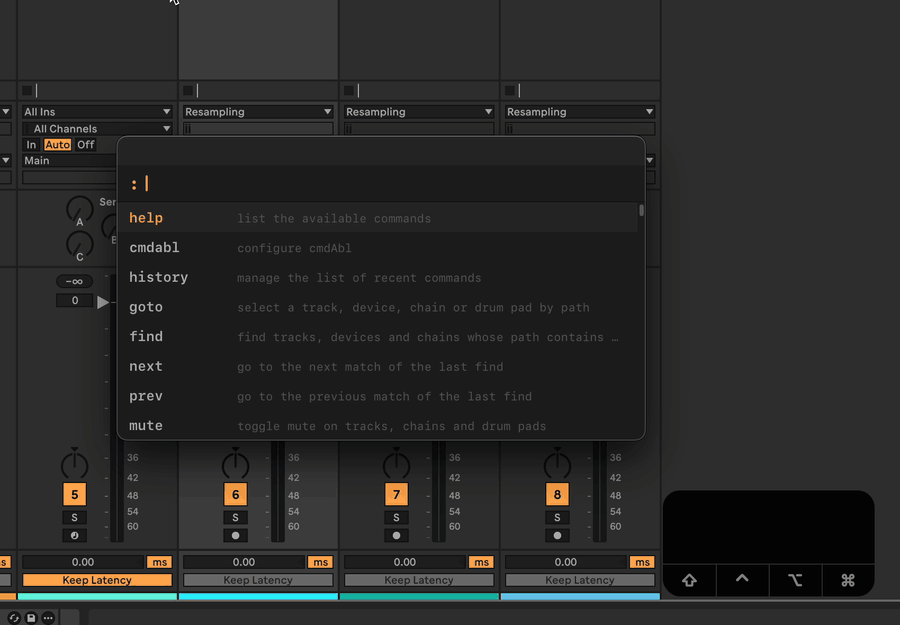

# cmdAbl

**A command palette for Ableton Live.**

cmdAbl is a keyboard command palette inside Live. Press `:`, type a verb and a target, such as `mute drums`,
`goto /Lead` or `tag /Lead fx`. cmdAbl resolves names, paths and tags to tracks, devices, chains and Drum Rack
pads, asks with a pick list when it is unsure, and grows through modules. It is built on the Ableton Extensions
SDK, with a small Remote Script for what the SDK cannot do.

📖 [Read the documentation](https://marvinhauke.github.io/cmdAbl/) · 🚀 [Get started](https://marvinhauke.github.io/cmdAbl/getting-started/)

## Contents

- [Why cmdAbl](#why-cmdabl)
- [Modules](#modules)
- [Requirements](#requirements)
- [Install](#install)
- [Documentation](#documentation)
- [Develop](#develop)
- [Contributing](#contributing)
- [License](#license)

## Why cmdAbl

### Tags that group your tracks

Tag tracks by what they are: `tag /Lead fx synth`. After that, `mute #fx` reaches every track tagged `fx` at once,
`mute !#drums` every regular track without the tag, and `mute drums` works when no track name matches it. `tag -l`
opens the tag board, where you add and remove the tags of every track. Tags are saved with the Set, and they need
the [Remote Script](https://marvinhauke.github.io/cmdAbl/remote-script/).

### A pick list you control

When a name fits more than one object, cmdAbl asks instead of guessing. Mark the rows you mean with `Tab`. The
buttons show the state that `Enter` would set: a speaker for `mute`, `S` for `solo`, a record dot for `arm` and a box
for `tag -e`. A dashed ring marks each one that would change. Live does not change until you press `Enter`.

### Community extensions, one list

pakabl installs Ableton Live extensions from a curated list of community repositories. Run `pakabl update` once,
then `pakabl list` shows each extension with an Install button. Restart Live after a change.

More: [Using cmdAbl](https://marvinhauke.github.io/cmdAbl/using/)

## Modules

These commands ship with cmdAbl. Each feature is a module that declares its commands:

- `find`: find tracks, devices and chains whose path contains a pattern.
- `goto`: select a track, device, chain or drum pad by path.
- `next`, `prev`: go to the next or previous match of the last `find`.
- `mute`, `solo`: toggle mute or solo on tracks, chains and drum pads.
- `arm`: toggle record arm on tracks.
- `tag`: tag tracks; `tag -l` opens the tag board, `tag -e` switches one tag on many tracks, `tag -r` renames a tag.
- `help`, `man`, `lom`: list the commands; show a command's full page in Live, or open the Live manual or the cmdAbl
  documentation; show the Live Object Model path of a track, device or chain.
- `history`: manage the list of recent commands.
- `pakabl`: install and manage Ableton Live extensions.
- `cmdabl setup`, `cmdabl bridge`, `cmdabl log`: install the key trigger and the Remote Script; show the Remote
  Script's status; show cmdAbl's log.

More: [Commands](https://marvinhauke.github.io/cmdAbl/reference/commands/) for the usage of each command, and
[Writing a command](https://marvinhauke.github.io/cmdAbl/guides/command-authoring/) to build a module.

## Requirements

- **macOS.** cmdAbl has been tested on macOS only.
- **Ableton Live with Extensions support.** The Extensions SDK is in beta; cmdAbl is built against version 1.0.0-beta.1.
- **[Karabiner-Elements](https://karabiner-elements.pqrs.org)** (free), for the `:` key. It is optional: the palette
  also opens from Live's context menu.
- **The cmdAbl Remote Script** (0.1.6, shipped with cmdAbl). `cmdabl setup` installs it; then choose it as Control
  Surface in Live. Selecting objects, mute and solo on rack chains and Drum Rack pads, and tags need it.

More: [Getting started → What you need](https://marvinhauke.github.io/cmdAbl/getting-started/#what-you-need)

## Install

You need a Mac and a Live with Extensions support (see [Requirements](#requirements)).

1. **Install [Karabiner-Elements](https://karabiner-elements.pqrs.org)** (free). This is optional: without it, open
   the palette from the context menu (right-click a clip, track, clip slot or scene and choose **: cmdAbl**).
2. **Install the extension.** Download the latest `.ablx` from the
   [Releases page](https://github.com/MarvinHauke/cmdAbl/releases/latest). In Live, open **Settings → Extensions**,
   and drag the file onto the box or click **Choose file**.
3. **Run `cmdabl setup`.** Open the palette from the context menu, type `cmdabl setup` and press Enter. It links the Karabiner rule and
   installs the Remote Script. Then in Karabiner-Elements, open **Complex Modifications → Add predefined rule**, choose **cmdAbl** and click **Enable**.
4. **Restart Live**, then open **Settings → Tempo & MIDI → MIDI** and choose **cmdAbl** under **Control Surface**.

More: [Getting started](https://marvinhauke.github.io/cmdAbl/getting-started/) explains each step, with screenshots.

## [Documentation](https://marvinhauke.github.io/cmdAbl/)

For users:

- [Getting started](https://marvinhauke.github.io/cmdAbl/getting-started/): install cmdAbl and try the first commands.
- [Using cmdAbl](https://marvinhauke.github.io/cmdAbl/using/): names, the pick list, tags, `find`, the log, history.
- [Remote Script](https://marvinhauke.github.io/cmdAbl/remote-script/): install, update, check and its messages.
- [Commands](https://marvinhauke.github.io/cmdAbl/reference/commands/): every command, generated from the code.
- [Known limits](https://marvinhauke.github.io/cmdAbl/limits/): what cmdAbl cannot do.

For extension authors: [List your extension in pakabl](https://marvinhauke.github.io/cmdAbl/pakabl-listing/).

## Develop

The [Develop](https://marvinhauke.github.io/cmdAbl/develop/) page covers getting the Ableton Extensions SDK (it is not
in this repository), building, testing and pull requests. The code is explained on the
[Architecture](https://marvinhauke.github.io/cmdAbl/architecture/) page.

## Contributing

- [Develop](https://marvinhauke.github.io/cmdAbl/develop/): build, test and send a pull request.
- [Writing a command](docs/guides/command-authoring.md)
- [List your extension in pakabl](docs/pakabl-listing.md)
- [CLAUDE.md](CLAUDE.md): how the agents that work on this repository are organised

For maintainers (these pages are not on the site):

- [Releasing cmdAbl](docs/guides/release-cmdabl.md)
- [CI and secrets](docs/guides/ci.md)
- [Running the pakabl index](docs/guides/pakabl-index.md)
- [Guides overview](docs/guides/README.md)

## License

MIT. See [LICENSE](LICENSE).
