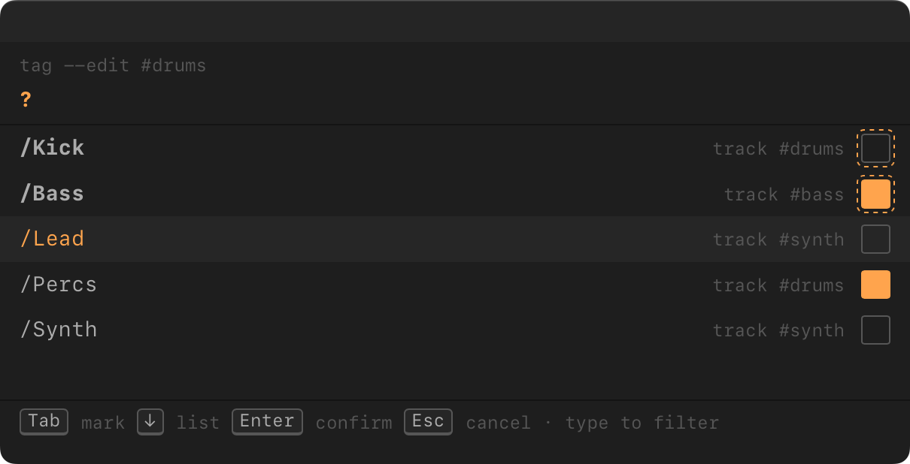

# cmdAbl

**A command palette for Ableton Live.** Press `:`, type what you want, such as `mute drums`, and Live does it.

📖 [Read the documentation](https://marvinhauke.github.io/cmdAbl/) · 🚀 [Get started](https://marvinhauke.github.io/cmdAbl/getting-started/)

## What it does for you

- **Type instead of click.** `mute drums`, `goto /Lead` or `vol -6 /Bass` act on your Set from the keyboard.
- **Groups of tracks with tags.** Tag tracks once (`tag /Lead fx`), then act on all of them: `mute #fx`.
- **Asks instead of guessing.** If a name fits several tracks, cmdAbl shows a pick list. Live changes only when you press `Enter`.
- **Installs community extensions.** The `pakabl` command lists extensions from a curated list and installs them for you.

## Before you start

- **A Mac.** cmdAbl has been tested on macOS only.
- **A Live beta with Extensions.** Extensions are Ableton's new way to add features to Live. Extensions are in Live's beta (Live 12.4.16, the current non-beta release, has none). This release is tested with the Live 12.4.25 beta. cmdAbl is built against Extensions SDK 1.0.0-beta.1.
- **[Karabiner-Elements](https://karabiner-elements.pqrs.org) (optional).** A free keyboard tool that lets the `:` key open cmdAbl. Without it, you open cmdAbl from a right-click menu.
- **The Remote Script.** A small helper (version 0.1.15) that ships inside cmdAbl. It lets cmdAbl select tracks and keep tags. The setup page copies it for you.

## Install in 4 steps

1. **Download** the latest `.ablx` file from the [Releases page](https://github.com/MarvinHauke/cmdAbl/releases/latest).
2. **Add it to Live:** open **Settings → Extensions** and drag the file onto the box.
3. **Open the setup page:** right-click a clip, track, clip slot or scene and choose **: cmdAbl**. The setup page opens. Use its buttons: **Get Karabiner**, **Add rule** or **Open Karabiner**, and **Copy**.
4. **Restart Live**, then open **Settings → Tempo & MIDI → MIDI** and choose **cmdAbl** under **Control Surface**.

[Getting started](https://marvinhauke.github.io/cmdAbl/getting-started/) shows each step with screenshots.

## First commands to try

Open the palette (`:`), type a line and press `Enter`.

| Type | What happens |
| --- | --- |
| `help` | lists every command |
| `goto /Lead` | selects the track Lead |
| `mute drums` | mutes the drum tracks; again unmutes them |
| `tag /Lead fx` | tags the track Lead with `fx` |
| `mute #fx` | mutes every track tagged `fx` |
| `tag -l` | opens the tag board |

## Commands

| Command | What it does |
| --- | --- |
| `find`, `goto`, `next`, `prev` | find tracks, devices and chains; select one; step through the matches |
| `mute`, `solo`, `arm` | toggle mute, solo or record arm |
| `vol` | change the fader level in dB |
| `tag` | tag tracks; `tag -l` opens the tag board |
| `map`, `midi` | bind a MIDI control to a command line; watch what your controller sends |
| `;` | run several commands in one line, such as `mute #drums; vol -6 #bass` |
| `note`, `history` | open the Set's note; manage recent commands |
| `help`, `man`, `lom` | list commands; show a command's page; show an object's Live Object Model path |
| `pakabl` | install and manage Live extensions |
| `cmdabl setup`, `cmdabl bridge`, `cmdabl log`, `cmdabl config` | check setup, the Remote Script and the log; change settings |

[Commands](https://marvinhauke.github.io/cmdAbl/reference/commands/) lists the usage of each one.

## Documentation

- [Getting started](https://marvinhauke.github.io/cmdAbl/getting-started/): install cmdAbl and try the first commands.
- [Using cmdAbl](https://marvinhauke.github.io/cmdAbl/using/): names, the pick list, tags, `find`, the log, history.
- [Remote Script](https://marvinhauke.github.io/cmdAbl/remote-script/): install, update, check and its messages.
- [Commands](https://marvinhauke.github.io/cmdAbl/reference/commands/): every command, generated from the code.
- [Known limits](https://marvinhauke.github.io/cmdAbl/limits/): what cmdAbl cannot do.
- [List your extension in pakabl](https://marvinhauke.github.io/cmdAbl/pakabl-listing/): for extension authors.

## Develop

- [Develop](https://marvinhauke.github.io/cmdAbl/develop/): get the SDK (it is not in this repository), build, test and send a pull request.
- [Architecture](https://marvinhauke.github.io/cmdAbl/architecture/) and [Writing a command](docs/guides/command-authoring.md).
- [CLAUDE.md](CLAUDE.md): how the agents that work on this repository are organised.

For maintainers (these pages are not on the site): [Releasing cmdAbl](docs/guides/release-cmdabl.md) · [CI and secrets](docs/guides/ci.md) · [Running the pakabl index](docs/guides/pakabl-index.md) · [Guides overview](docs/guides/README.md)

## License

MIT. See [LICENSE](LICENSE).
