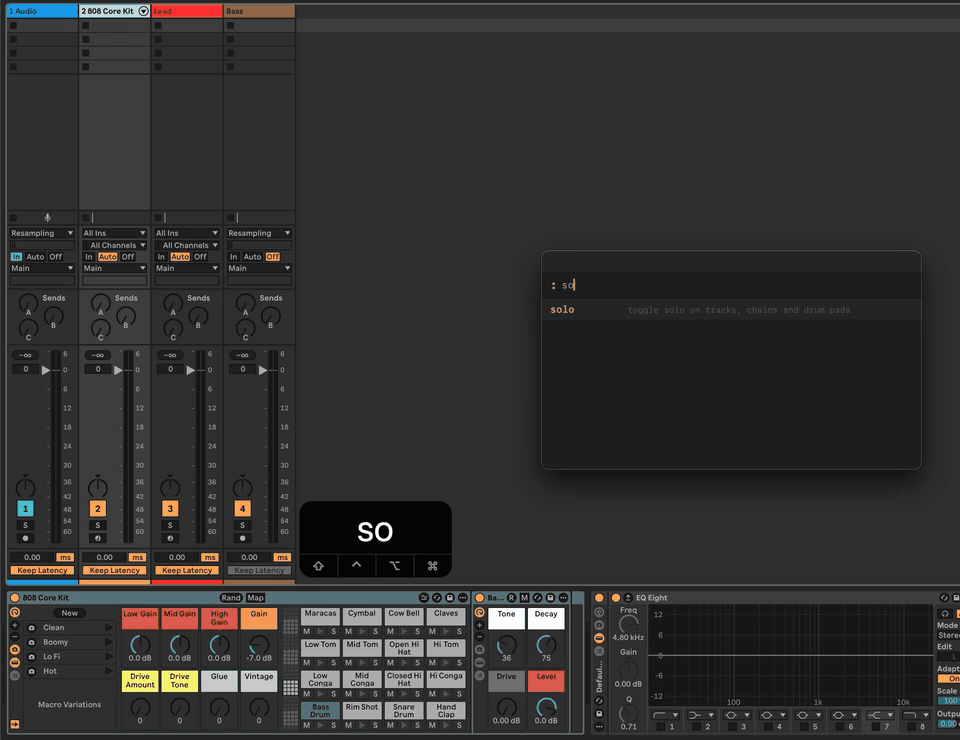

[](https://github.com/MarvinHauke/cmdAbl/releases/latest)
[](https://marvinhauke.github.io/cmdAbl/)
[](LICENSE)
[](https://marvinhauke.github.io/cmdAbl/limits/)

# cmdAbl

**A command palette for Ableton Live.**

cmdAbl is a keyboard command palette inside Live. Press `:`, type a verb and a target, such as `mute drums`,
`goto /Lead` or `tag /Lead fx`. cmdAbl resolves names, paths and tags to tracks, devices, chains and Drum Rack
pads, asks with a pick list when it is unsure, and grows through modules. It is built on the Ableton Extensions
SDK, with a small Remote Script for what the SDK cannot do.

📖 [Read the documentation](https://marvinhauke.github.io/cmdAbl/) · 🚀 [Get started](https://marvinhauke.github.io/cmdAbl/getting-started/)



<!-- GIF to come: docs/assets/images/hero.gif, tags in action (tag --set 1, mute drums, solo !#drums, mute --pick drums) -->

## Contents

- [Why cmdAbl](#why-cmdabl)
- [Modules](#modules)
- [Requirements](#requirements)
- [Install](#install)
- [Documentation](#documentation)
- [Develop](#develop)
- [Contributing](#contributing)
- [License](#license)

## Why cmdAbl

<!-- GIF to come: docs/assets/images/tags.gif -->

### Tags that group your tracks

Tag tracks by what they are: `tag /Lead fx synth`. After that, `mute #fx` reaches every track tagged `fx` at once,
`mute !#drums` every regular track without the tag, and `mute drums` works too when no track name matches it. Tags
are saved with the Set, and they need the [Remote Script](https://marvinhauke.github.io/cmdAbl/remote-script/).

### A pick list you control

When a name fits more than one object, `mute`, `solo` and `arm` ask instead of guessing. Mark the rows you mean
with `Tab`. Each row shows its state in Live's colours, a speaker for mute, `S` for solo or a record dot for arm,
and marked rows are highlighted. A dashed ring marks each button that Enter would change, and Live does not change
until you press Enter.


<!-- GIF to come: docs/assets/images/pakabl.gif -->

### Community extensions, one list

pakabl installs Ableton Live extensions from a curated list of community repositories. Run `pakabl update` once,
then `pakabl list` shows each extension with an Install button. Restart Live after a change.


More: [Using cmdAbl](https://marvinhauke.github.io/cmdAbl/using/)

## Modules

These commands ship with cmdAbl. Each feature is a module that declares its commands:

- `goto`: select a track, device, chain or drum pad by path.
- `find`, `next`, `prev`: find tracks, devices and chains whose path contains a pattern, and step through the matches.
- `mute`, `solo`: toggle mute or solo on tracks, chains and drum pads.
- `arm`: toggle record arm on tracks.
- `tag`: tag tracks, or list the tags of the Set.
- `history`: manage the list of recent commands.
- `man`: show a command's full page in Live, or open the Live manual or the cmdAbl documentation.
- `lom`: show the Live Object Model path of a track, device or chain.
- `pakabl`: install and manage Ableton Live extensions.
- `cmdabl setup`, `cmdabl bridge`: install the key trigger and the Remote Script; show the Remote Script's status.
- `help`: list the available commands.

More: [Command reference](https://marvinhauke.github.io/cmdAbl/reference/commands/) for the usage of each command,
and [Writing a command](https://marvinhauke.github.io/cmdAbl/guides/command-authoring/) to build a module.

## Requirements

- **macOS.** cmdAbl has been tested on macOS only.
- **Ableton Live with Extensions support.** The Extensions SDK is in beta; cmdAbl is built against version 1.0.0-beta.1.
- **[Karabiner-Elements](https://karabiner-elements.pqrs.org)** (free), for the `:` key. It is optional: the palette
  also opens from Live's context menu.
- **The cmdAbl Remote Script.** `cmdabl setup` installs it; then choose it as Control Surface in Live. Selecting
  objects, mute and solo on rack chains and Drum Rack pads, and tags need it.

More: [Getting started → What you need](https://marvinhauke.github.io/cmdAbl/getting-started/#what-you-need)

## Install

You need a Mac and a Live with Extensions support (see [Requirements](#requirements)).

1. **Install [Karabiner-Elements](https://karabiner-elements.pqrs.org)** (free). This is optional: without it, open
   the palette from the context menu (right-click a clip, track, clip slot or scene and choose **: cmdAbl**).
2. **Install the extension.** Download the latest `.ablx` from the
   [Releases page](https://github.com/MarvinHauke/cmdAbl/releases/latest). In Live, open **Settings → Extensions**,
   and drag the file onto the box or click **Choose file**.
3. **Run `cmdabl setup`.** Open the palette, type `cmdabl setup` and press Enter. It links the Karabiner rule and
   installs the Remote Script. Then in Karabiner-Elements, open **Complex Modifications → Add predefined rule**, choose **cmdAbl** and click **Enable**.
4. **Restart Live**, then open **Settings → Tempo & MIDI → MIDI** and choose **cmdAbl** under **Control Surface**.

More: [Getting started](https://marvinhauke.github.io/cmdAbl/getting-started/) explains each step, with screenshots.

## [Documentation](https://marvinhauke.github.io/cmdAbl/)

The documentation site has:

- [Getting started](https://marvinhauke.github.io/cmdAbl/getting-started/): install cmdAbl and try the first commands.
- [Using cmdAbl](https://marvinhauke.github.io/cmdAbl/using/): names, the pick list, tags, pads and chains, history.
- [Remote Script](https://marvinhauke.github.io/cmdAbl/remote-script/): install, update, check and its messages.
- [Command reference](https://marvinhauke.github.io/cmdAbl/reference/commands/): every command, generated from the code.
- [Known limits](https://marvinhauke.github.io/cmdAbl/limits/): what does not work yet.

## Develop

The Ableton Extensions SDK is licensed for building extensions, not for redistribution, so it is not in this
repository. `docs/feature-plans/` holds the design plans.

```sh
npm install              # dependencies (the SDK tarballs go into vendor/, see the Architecture page)
npm test                 # unit tests
npm run build            # type-check and production bundle
npm run package          # build the .ablx
npm run docs:reference   # regenerate the reference pages from the code
```

More: [Architecture](https://marvinhauke.github.io/cmdAbl/architecture/) explains the code.

## Contributing

- [Writing a command](docs/guides/command-authoring.md)
- [pakabl index](docs/guides/pakabl-index.md): getting an extension onto the community list
- [CLAUDE.md](CLAUDE.md): how the agents that work on this repository are organised

## License

MIT. See [LICENSE](LICENSE).
