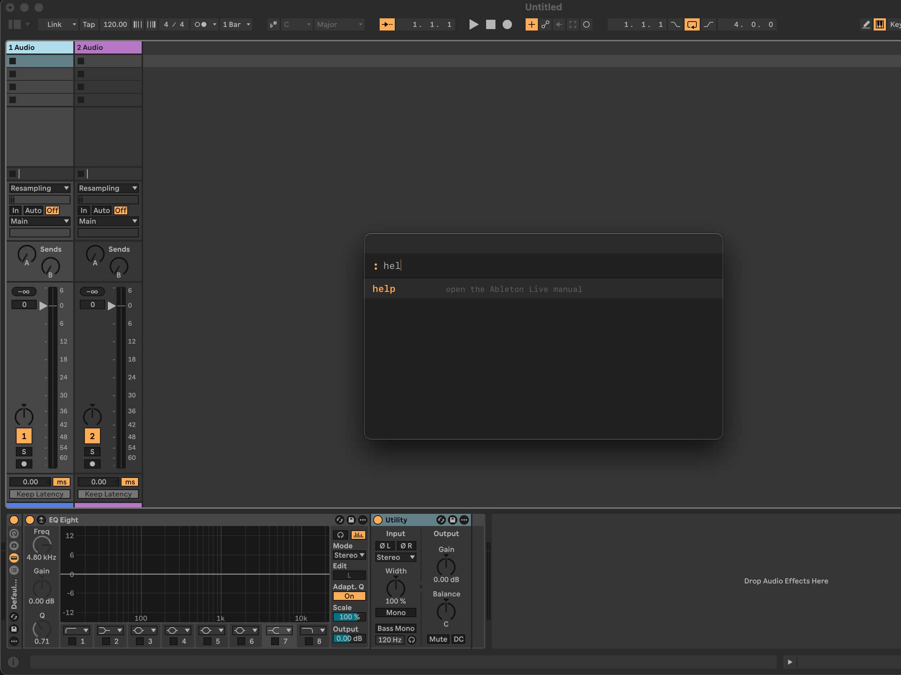
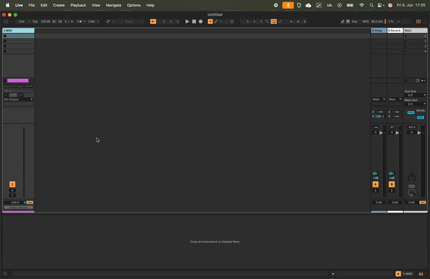
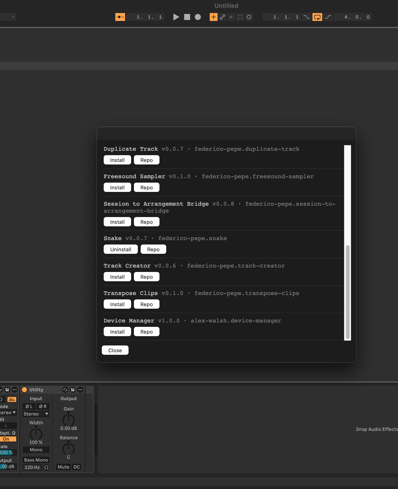

# cmdAbl

A command palette for Ableton Live.

Press `:` while Live is focused to open a
keyboard-driven command input with fuzzy filtering, tab completion, and POSIX-style flag arguments.
You are invited to add your own extensions as registered commands.

📖 **Documentation and guides:** https://marvinhauke.github.io/cmdAbl/

- [How it works](#how-it-works)
- [Installation](#installation)
- [Adding your extension to pakabl](#pakabl-index)
- [Development](#development)
- [Scripts](#scripts)
- [Project structure](#project-structure)

<figure>

<figcaption>open the manual with help command</figcaption>
</figure>

---

<details id="how-it-works" open>
<summary><b>How it works</b></summary>
<br>

cmdAbl registers a persistent HTTP server inside the extension host. Karabiner Elements watches
for `:` while Ableton is frontmost and fires a `curl` request to that server, which opens the
command palette modal. Commands are registered in TypeScript and injected into the UI at open
time, so the palette always reflects the live command set.

**Palette keybindings**

| Key       | Action                                |
| --------- | ------------------------------------- |
| Type      | Filter commands / flags               |
| `Tab`     | Complete selected item into the input |
| `Enter`   | Execute selected command              |
| `↑` / `↓` | Navigate the list                     |
| `Esc`     | Close without executing               |

**Command syntax**

Commands follow a POSIX-style flag pattern:

```
commandName [--flag]
```

Typing a command name followed by a space switches the dropdown into flag-completion mode.

**Built-in commands**

| Command           | Description                                                                                              |
| ----------------- | -------------------------------------------------------------------------------------------------------- |
| `help`            | List the available commands                                                                              |
| `cmdabl`          | Show the usage of `cmdabl` (also `cmdabl --help`; documentation: `man cmdabl`)                           |
| `cmdabl bridge`   | Show the Remote Script status: version, response time in ms, operations                                  |
| `cmdabl setup`    | Install keyboard trigger and Remote Script, then say what to do next                                     |
| `pakabl list`     | Browse and install community extensions — see _Install more extensions with `pakabl`_ under Installation |

**Default modules**

cmdAbl ships with a few small built-in modules (`src/modules/`) that double as examples for
your own:

| Module    | Capability                                                                 |
| --------- | -------------------------------------------------------------------------- |
| `goto`    | `goto [--unfold] <path>` selects a track, device or chain / drum pad (via the Remote Script bridge); `--unfold` also shows the track's chains in the Session mixer (never folds); they are also listed in the palette |
| `find`    | `find [--unfold] <pattern> [-t] [-d] [-c]` — every track, device and chain (rack chains, Drum Rack pads) whose path contains the pattern; the flags narrow it to tracks, devices or chains; `next` / `prev` step through the matches and keep the `find`'s `--unfold` |
| `mute`    | `mute <track-or-chain>…` toggles mute per track, rack chain or Drum Rack pad; `unmute …` always unmutes. Tracks need no Remote Script and are applied separately from chains; chains do (macOS) |
| `solo`    | `solo <track-or-chain>…` toggles solo per track, rack chain or Drum Rack pad; `unsolo …` always unsolos. Tracks need no Remote Script and are applied separately from chains; chains do (macOS) |
| `arm`     | `arm <track>…` toggles record arm per track; `unarm <track>…` always disarms; return, main and group tracks cannot be armed and are reported as failed; with the Remote Script, so are tracks Live greys out (e.g. a MIDI track whose input device is not available — checked after the write, as the Live API cannot tell beforehand; a refused `arm` may leave an extra undo step); a script enabled mid-session is noticed after `cmdabl bridge` or a `goto` |
| `history` | Remembers your last 20 invocations and re-offers them as rerunnable entries |
| `man`     | `man <topic>` opens a manual in the browser: `man ableton` (Live reference manual), `man cmdabl` (this documentation). `man ableton <words>` searches the Live 12 manual through Ecosia, e.g. `man ableton warp modes` |
| `pakabl`  | Install/update/uninstall community extensions — see _Install more extensions with `pakabl`_ |

**Addressing tracks and devices**

Commands take paths such as `/Drums/Kick`. A path may be partial (`kick`), and names with
spaces need no quotes for a single target (`goto /Opal Lead`). Same-named siblings are told
apart by an ordinal: `/Drums/Kick`, `/Drums/Kick#2`.

When a path matches more than one object, cmdAbl shows a **pick list** instead of guessing:
type to filter (`Space` types a space), `↑`/`↓` to move, `Enter` to choose, `Esc` to cancel.
Commands that take several tracks (`mute`, `solo`, `arm`, …) let you mark several with `Tab`, or
with `Space` once you are in the list (the first `↑`/`↓` only enters it, so `↓` `Space` marks the
first row; typing a character returns to the filter).
A line above the filter shows the command `Enter` will run. That resolved command is what lands
in the history, so re-running it never asks again.

**Live objects**

The palette also fuzzy-searches the current Set. Type part of a track name and
hit enter to select that track. The track list is snapshotted each time the
palette opens.

> **Note:** selecting a track requires the companion **cmdAbl Remote Script**
> (the Extensions SDK cannot change Live's selection). See _Remote Script
> bridge_ under Installation. Without it, the palette still opens and runs
> commands; `goto`, `find`, `next`, `prev` and picking an object in the palette
> report "Remote Script not running / not installed / outdated" instead
> of selecting.

</details>

---

<details id="installation" open>
<summary><b>Installation</b></summary>
<br>

**Prerequisites**

| Platform | Required                                                                                               |
| -------- | ------------------------------------------------------------------------------------------------------ |
| macOS    | [Ableton Live 12](https://www.ableton.com) · [Karabiner-Elements](https://karabiner-elements.pqrs.org) |
| Windows  | [Ableton Live 12](https://www.ableton.com) · [AutoHotkey v2](https://www.autohotkey.com)               |

> **Platform note:** cmdAbl has only been tested on macOS so far — the Windows paths and
> setup flow (`%APPDATA%\Ableton\Live Extensions`, the AutoHotkey trigger, the Remote Script
> location) are implemented but unverified on a real Windows machine. If you develop on
> Windows and want to help, trying the install/setup flow and
> [opening an issue](https://github.com/MarvinHauke/cmdAbl/issues) with what you find
> (or a PR with fixes) would be very welcome.

**1. Install the extension**

Download the latest `.ablx` from the [Releases page](https://github.com/MarvinHauke/cmdAbl/releases/latest) and double-click it — Ableton Live installs and loads the extension automatically.

**2. Open the palette**

Right-click any clip, track, clip slot, or scene and choose **: cmdAbl**.

**3. Set up the `:` keyboard shortcut**

Run the following command in the palette — it both links the keyboard trigger
**and** copies the companion Remote Script into place for step 4 below:

```
cmdabl setup
```

<details>
<summary><b>macOS</b></summary>
<br>

Make sure [Karabiner-Elements](https://karabiner-elements.pqrs.org) is installed first.
A feedback dialog confirms whether the rule was linked or shows an error. Then open
**Karabiner-Elements → Complex Modifications → Add rule** and enable
**"Open cmdAbl command palette with ':' when Ableton Live is focused"**.



> **Keyboard layout note:** The rule maps `Shift+Period` (`:` on QWERTZ/German layouts).
> If you use a different layout, edit `karabiner/cmdabl.json` and change `"key_code"` to
> match your key — use Karabiner's Event Viewer to find the correct code.

</details>

<details>
<summary><b>Windows</b></summary>
<br>

Make sure [AutoHotkey v2](https://www.autohotkey.com) is installed first. A feedback
dialog confirms the script was copied to your startup folder. Open `cmdabl.ahk` manually
to activate it immediately, or restart Windows to auto-start it.

</details>

**4. Link the Remote Script (enables track selection)**

Selecting a track from the palette needs a small companion Remote Script, because Live's
Extensions SDK has no API to change the selection itself — `cmdabl setup` (step 3) already
copied it into Live's User Library for you:

- **macOS:** `~/Music/Ableton/User Library/Remote Scripts/cmdAbl`
- **Windows:** `~/Documents/Ableton/User Library/Remote Scripts/cmdAbl`

Copying the files isn't enough on its own — Live also needs to be told to *load and connect*
to the script, and that's a one-time **manual link** with no API to automate it:

1. **Restart Live** so it picks up the new Remote Script (a copy alone doesn't load it).
2. Open **Settings → Link, Tempo & MIDI → MIDI**, and under **Control Surface** pick
   **cmdAbl** (leave Input/Output set to _None_). This is the actual "linking" step —
   it tells Live which Control Surface script to run and connect to the palette's bridge.

Live's log will show `cmdAbl bridge listening on 127.0.0.1:27185` once the link is active.
Without it, the palette still opens and runs commands — only track selection is a no-op.

**5. Install more extensions with `pakabl`**

cmdAbl bundles `pakabl`, a small package manager for a curated list of community extensions.
Run `pakabl update` once to fetch the index, then browse and manage extensions entirely from
the palette:

| Command                          | What it does                                                                |
| -------------------------------- | --------------------------------------------------------------------------- |
| `pakabl list`                    | Browse the curated list in a UI — Install / Update / Uninstall, or jump to each extension's repo, all with one click |
| `pakabl install <id>`            | Download and install one extension by id (e.g. `federico-pepe.snake`)       |
| `pakabl update`                  | Refresh the cached curated index                                            |
| `pakabl upgrade <id>[@<version>]` | Re-install the index's version (`@<version>` states the version you expect) |
| `pakabl uninstall <id>`          | Remove an installed extension                                               |

<figure>

<figcaption><code>pakabl list</code>: each entry's button reflects its install status (Install / Update / Uninstall), with a Repo button to jump to its source.</figcaption>
</figure>

As with any `.ablx`, **restart Live** after installing, upgrading, or uninstalling for the
change to take effect.

</details>

---

<details id="pakabl-index" open>
<summary><b>Adding your extension to pakabl</b></summary>
<br>

The list `pakabl` shows is [`pakabl/index.json`](pakabl/index.json). It is generated and
kept up to date automatically from a set of approved GitHub repos, so you don't edit it by hand.

To get your extension listed, open a pull request that adds one line to
[`pakabl/sources.json`](pakabl/sources.json):

```json
{ "repo": "<owner>/<repo>" }
```

Requirements: the repo publishes a built `.ablx` (as a GitHub Release asset or a committed
file) whose `manifest.json` has `name`, `author`, `version` and a `minimumApiVersion` starting
with `1.`. The extension id shown in `pakabl list` is `<author-slug>.<name-slug>` from that
manifest (author `"Federico Pepe"` + name `"Track Creator"` → `federico-pepe.track-creator`).
New versions you publish are picked up automatically.

Tagging your repo with the GitHub topic `ableton-extension` also makes it show up as a
candidate for review. Details of the process: [pakabl index guide](https://marvinhauke.github.io/cmdAbl/guides/pakabl-index/).

</details>

---

<details id="development" open>
<summary><b>Development</b></summary>
<br>

**1. Install dependencies**

```sh
npm install
```

**2. Run the extension in dev mode**

```sh
npm start
```

This type-checks, bundles, and loads the extension into Ableton's Extension Host with live reload.

**3. Add commands**

All commands are registered on the `CommandRegistry` instance in `src/extension.ts`:

```ts
registry.register("mycommand", "description shown in the palette", (flags) => {
  // flags is string[] of everything typed after the command name
});

// with declared flags for tab-completion:
registry.register(
  "mycommand",
  "description",
  [{ name: "--option", description: "what this flag does" }],
  (flags) => {
    if (flags.includes("--option")) {
      /* ... */
    }
  },
);
```

Extensions must export an `activate(context: ActivationContext)` function.

</details>

---

<details id="scripts" open>
<summary><b>Scripts</b></summary>
<br>

```sh
npm start          # type-check, build (dev), and run in Live's Extension Host
npm test           # unit tests for the command platform (tokenizer, parser, validator)
npm run package    # production build + create a .ablx archive (includes karabiner/ and windows/)
```

Maintainers: how a release is cut, how the pakabl list is refreshed, and what CI does are
described in the [guides](https://marvinhauke.github.io/cmdAbl/guides/).

</details>

---

<details id="project-structure" open>
<summary><b>Project structure</b></summary>
<br>

```
src/
  extension.ts       main entry point — registers commands, starts HTTP server
  commandRegistry.ts typed command registry with flag support
  httpTrigger.ts     localhost HTTP server for external triggers (Karabiner, AHK, etc.)
  setup.ts           platform-specific keyboard trigger setup (macOS + Windows)
  modules/           built-in commands (goto, mute, solo, history, pakabl)
  ableton/           object tree and Remote Script bridge
remote-script/       companion Remote Script (track/device selection)
pakabl/              extension list: sources.json (approved repos), generated index.json
scripts/             pakabl-crawl.ts — regenerates the pakabl list
docs/                guides/ (maintainer how-tos), feature-plans/, sdk-tree.md
ui/
  interface.html     command palette (self-contained HTML/CSS/JS, inlined at build time)
karabiner/
  cmdabl.json        Karabiner Elements complex modification (macOS)
windows/
  cmdabl.ahk         AutoHotkey v2 script (Windows)
assets/
  images/            screenshots and videos for this README
```

</details>
