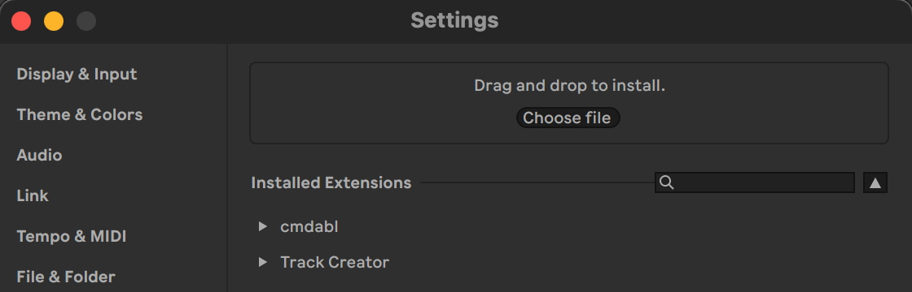
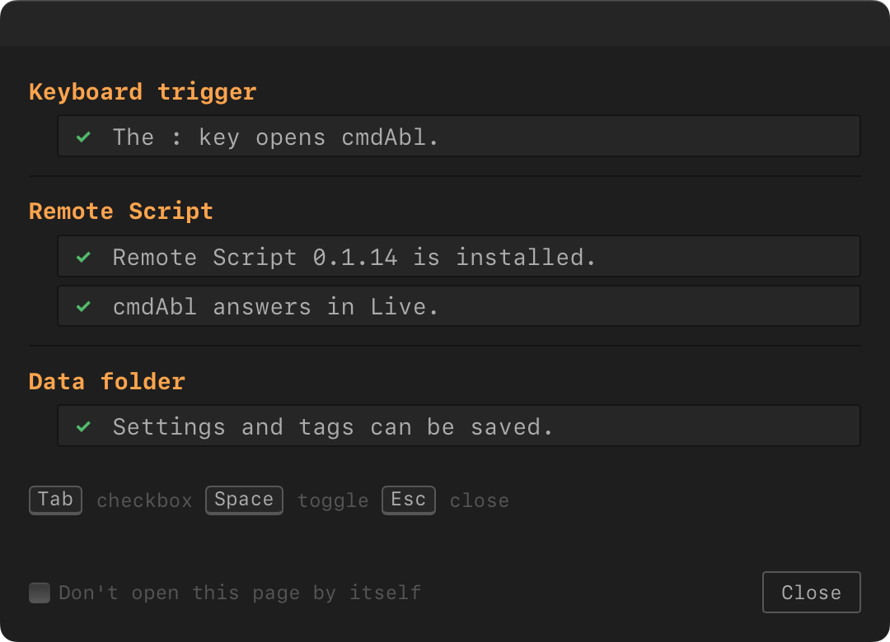
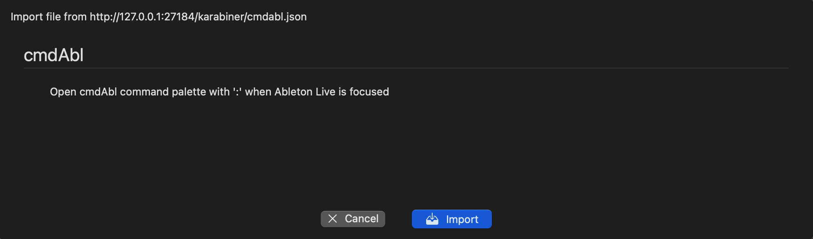
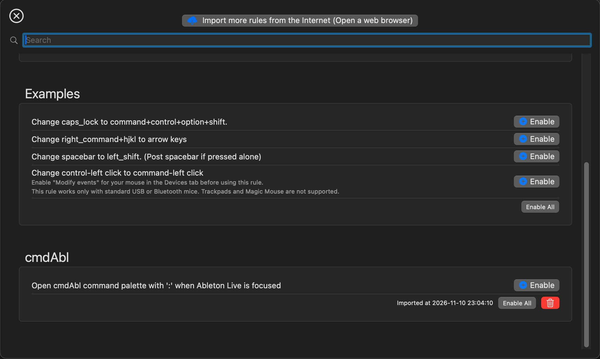
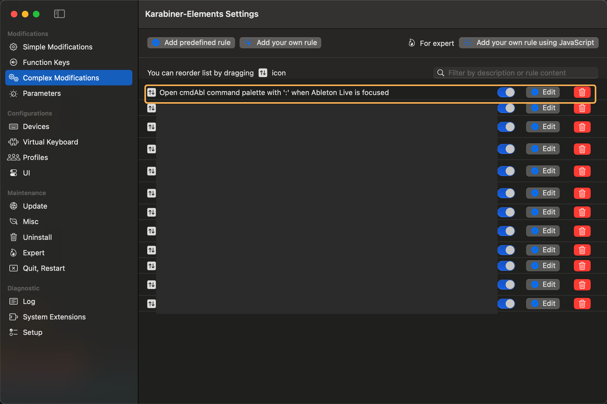
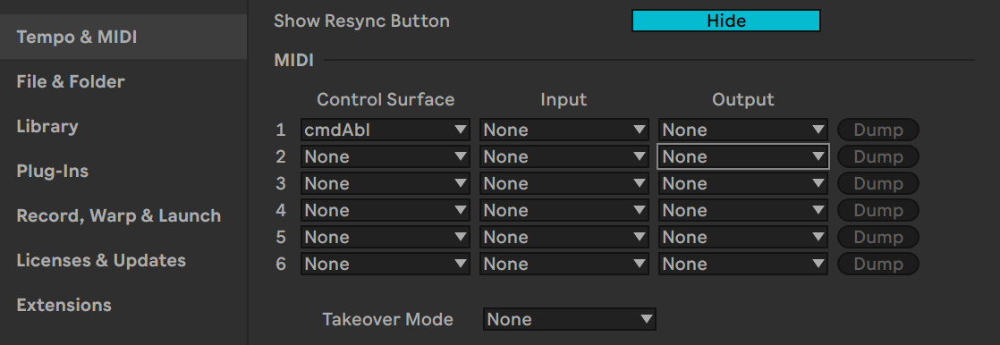
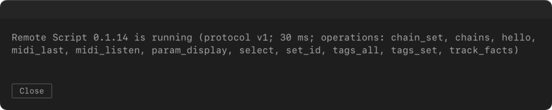
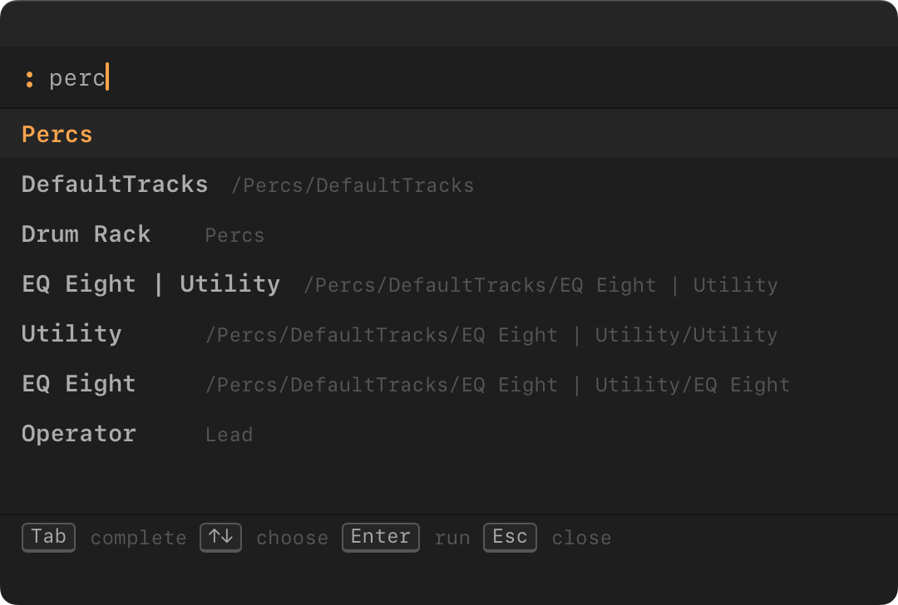
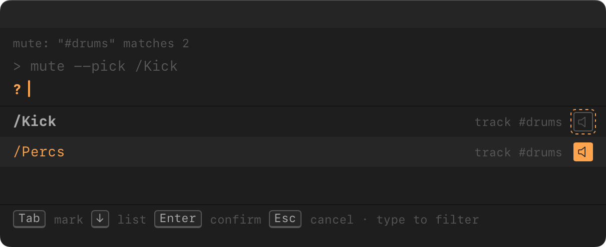

# Getting started

cmdAbl is a command palette for Ableton Live. You type a short line such as `mute /Bass`, and cmdAbl runs it on
the Set that is open. This page takes you from installing cmdAbl to your first commands. Follow the steps in order.

## What you need

- A Mac. cmdAbl has been tested on macOS only.
- A version of Ableton Live with Extensions support. The Extensions SDK is in beta; cmdAbl is built against
  version 1.0.0-beta.1 of it. This release is tested with the Live 12.4.25 beta
  (Live 12.4.16, the current non-beta release, has no Extensions).
- [Karabiner-Elements](https://karabiner-elements.pqrs.org) (free), for the `:` key. This is optional. Without it,
  you open the palette from a context menu. If you want it, install it before step 2, or use the button on the setup page.

## 1. Install the extension

Download the latest `.ablx` file from the
[Releases page](https://github.com/MarvinHauke/cmdAbl/releases/latest). Then open Live's **Settings → Extensions**
and either drag the `.ablx` file onto the box that says "Drag and drop to install", or click **Choose file** and pick
it. `cmdabl` then appears under "Installed Extensions". If an older cmdAbl is installed, remove it first and restart
Live.

*Settings → Extensions: drag the `.ablx` onto the box, or click Choose file.*

## 2. Check the setup page

The `:` key does not work yet, so open the palette from the context menu: right-click a clip, a track, a clip slot
or a scene, and choose **: cmdAbl**. The first time you open the palette after installing cmdAbl, the **setup page** opens first.
Later it opens by itself only when something new needs you, such as a new Remote Script after an update.
To open it any time, type `cmdabl setup` in the palette and press `Enter`.

The page has one row per step. A mark at the start of the row tells you where it stands: ✓ is done, ! needs you,
and ✗ failed. Where a step needs you, the row has a button.

On a fresh Mac, the page looks like this. Karabiner-Elements and the Remote Script are not installed yet, so
their rows show ! and a button:

Use the buttons described below to fix each ! row. When every row shows ✓, the page looks like this:

What each row does:

- **Keyboard trigger.** Without Karabiner-Elements, `:` does not open cmdAbl. If it is not installed, **Get
  Karabiner** opens its download page; install it and run `cmdabl setup` again. If it is installed, **Add rule**
  opens Karabiner's own import dialog. Click **Import**, then **Enable** (see [Set a hotkey for cmdAbl](#set-a-hotkey-for-cmdabl)). The rule opens the palette with `:`
  (Shift+period, which types `:` on German (QWERTZ) keyboards) while Ableton Live is focused. If the row says the
  rule is added but not enabled, **Open Karabiner** opens Karabiner's settings; enable the rule under **Complex Modifications**.
- **Remote Script.** **Copy** copies the companion Remote Script into Live's User Library, in
  `~/Music/Ableton/User Library/Remote Scripts/cmdAbl`. **Update** appears when the copy there is older than the one
  that comes with this cmdAbl. The Remote Script lets cmdAbl select tracks, change rack chains and pads, and keep
  tags.
- **Restart Live** and **control surface.** These rows tell you what is left. The control surface row has a **How**
  button that opens this page. Step 3 explains them.
- **Data folder.** It turns ✗ if cmdAbl cannot write to its data folder. Then your settings and tags are not saved.

At the bottom, the box **Don't open this page by itself** stops the automatic opening. You can also set it on the
[settings page](using.md#settings) as `setup.openOnStart`, in the Setup group.

The Setup group has a second setting, `setup.autoScript`. When it is on, cmdAbl copies a newer Remote Script at
start without asking. Live still needs one restart to load it. A first install still goes through **Copy**, unless you turned this setting on first.

Two commands do the same as the buttons, in case you prefer to type:

- `cmdabl setup script` copies or updates the Remote Script.
- `cmdabl setup karabiner` links cmdAbl's Karabiner rule into Karabiner-Elements without the import dialog. In
  Karabiner, open **Complex Modifications → Add predefined rule**, choose **cmdAbl** and click **Enable**.

## Set a hotkey for cmdAbl

Karabiner-Elements turns the `:` key into "open cmdAbl", and only while Live is the front application. cmdAbl
brings the rule with it. You add it once.

1. In the setup page, click **Add rule** in the Keyboard trigger row. Karabiner's import window opens and asks to
   import the rule. Click **Import**.

    

2. Find the group **cmdAbl** and click **Enable** next to "Open cmdAbl command palette with ':' when Ableton Live is focused".

    

3. Check the result in Karabiner's settings under **Complex Modifications**. The rule is in the list and its switch is on.

    

4. Switch to Live and press `:`. The palette opens.

If Karabiner asks for permissions the first time, allow them in macOS **System Settings → Privacy & Security**.

!!! info "Advanced: use another key"
    The key is part of the rule. In **Complex Modifications**, open the rule's JSON (**Edit**, or the imported file in `~/.config/karabiner/assets/complex_modifications/`).
    The key is in `from`: `"key_code": "period"` with `"mandatory": ["left_shift"]`, which is `:` on a German
    keyboard. Change `key_code` and `mandatory` to the key you want. Leave `to` and `conditions` as they are.
    The same rule is in the file `karabiner/cmdabl.json` of the
    [repository](https://github.com/MarvinHauke/cmdAbl).

## 3. Turn on the Remote Script in Live

After you copy the script, the setup page shows "Restart Live once to load Remote Script …". The copied script does not
appear in Live's Control Surface list until Live restarts. Do both steps:

1. **Restart Live.** After the restart, cmdAbl appears in the Control Surface list.
2. Open **Settings → Tempo & MIDI → MIDI**. Under **Control Surface**, choose **cmdAbl**. Leave Input and Output
   set to *None*. Choosing it starts the script; you do not need to restart Live again.

!!! warning "Restart Live after a Remote Script update"
    A new copy of the Remote Script is loaded only when Live starts. After an **Update**, restart Live once.

When it works, `cmdabl setup` shows "cmdAbl answers in Live." with a ✓.

*Settings → Tempo & MIDI → MIDI: Control Surface set to cmdAbl, Input and Output set to None.*

Check that it works:

- Run `cmdabl bridge` in the palette. It sends one request to the Remote Script and reports its version, the protocol
  version, the response time and the operations it supports.
- Live's log also shows `cmdAbl [script] listening on 127.0.0.1:27185`. That line appears once cmdAbl is chosen as
  Control Surface (after you copy the script and restart). The log is `~/Library/Preferences/Ableton/Live <version>/Log.txt`, where `<version>` is
  your Live version. The Remote Script's lines contain `RemoteScriptMessage: (cmdAbl)`.

*`cmdabl bridge` on a current install.*

If `cmdabl bridge` says the script is not running, the [Remote Script](remote-script.md) page explains each message
and what to do.

## 4. Open the palette

With the rule from step 2, press `:` with Live focused. (On German keyboards that is Shift+period.) The context menu
from step 2 works too.

| Key | What it does |
| --- | ------------ |
| Type | filters commands and objects of the Set |
| `Tab` | completes the selected item into the input |
| `Enter` | runs the typed line or the selected item |
| `↑` / `↓` | moves through the list (`Ctrl+n` / `Ctrl+p` do the same) |
| `Esc` | closes the palette without running anything |

*Type part of a name: tracks, devices and chains appear as rows. Enter selects the highlighted one.*

## 5. Try your first commands

Type each one in the palette and press `Enter`.

- `help` lists every command with a one-line summary. `mute --help` shows the usage of one command, and
  `man mute` its full page.
- `goto /Lead` selects the track Lead in Live. Partial names work too: `goto lead`.
- `mute /Bass` mutes the track Bass, and again unmutes it. `mute --set 1 /Bass` mutes it whatever its state;
  `mute --set 0 /Bass` unmutes it.
- Tag two of your tracks, for example `tag /Kick drums` and `tag /Percs drums`. Then `mute drums` mutes both at once.
- `tag -e` opens the tag editor, where you see every tag and its tracks and change them. `tag -l` lists the tags.

When a name matches more than one object, cmdAbl shows a **pick list** instead of guessing. Type to filter, press
`↑` and `↓` to move, `Enter` to choose and `Esc` to cancel. Commands that take several tracks, such as `mute`, let
you mark more than one row with `Space`: press `↓` to enter the list, then `Space` on each row.

*A name that matches several tracks opens the pick list. The line above the filter shows the command that Enter
will run, and the buttons show the state that Enter would set.*

[Using cmdAbl](using.md) covers names, the pick list and tags in full.

## What works without the Remote Script

The palette, `help`, `man`, `lom`, `cmdabl log` and the history work without the Remote Script. So do `mute`, `solo`
and `arm` on tracks. These need it:

- Track selection: `goto`, `find` (also `find next` and `find prev`), and picking an object row in the palette. They report that the
  Remote Script is not running and select nothing.
- Tags: `tag`, and targets such as `#fx`.
- `mute` and `solo` on rack chains and Drum Rack pads. These also need macOS.

With the Remote Script, `arm` also reports tracks that Live will not arm, such as a MIDI track whose input device
is unavailable. Return, main and group tracks cannot be armed at all.

## Install more extensions with pakabl

`pakabl` installs Ableton Live extensions from cmdAbl's curated list. Run `pakabl update`, then `pakabl list`.
See [pakabl](pakabl.md).

## Next steps

- [Using cmdAbl](using.md) explains names, the pick list, tags, `find`, the log and the history.
- [Remote Script](remote-script.md) explains updating, checking and the messages.
- [Commands](reference/commands.md) lists every command.
- Write extensions? [Add your extension to pakabl](develop-pakabl.md). Want to change cmdAbl? See
  [Develop](develop.md).
