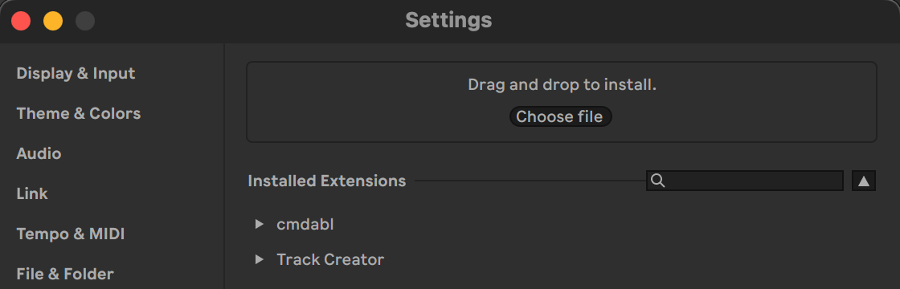
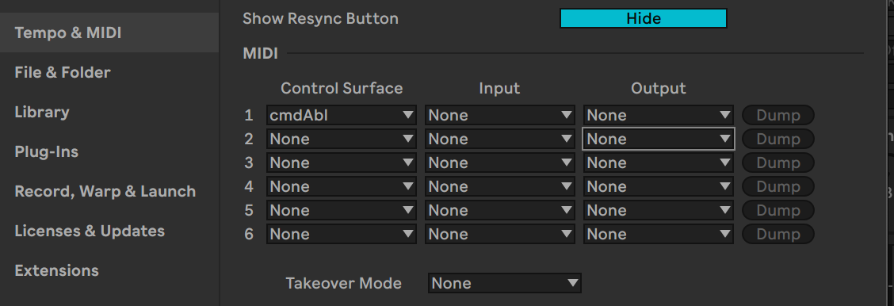
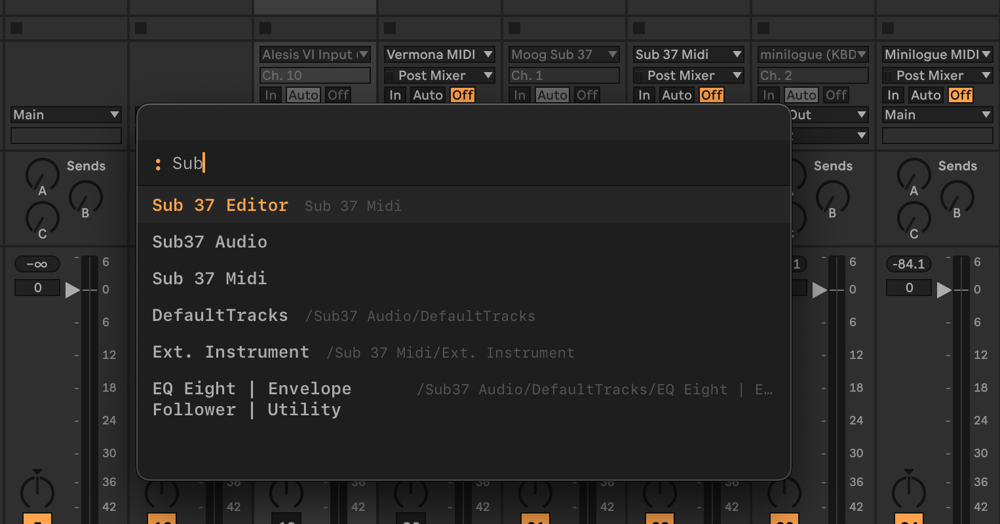
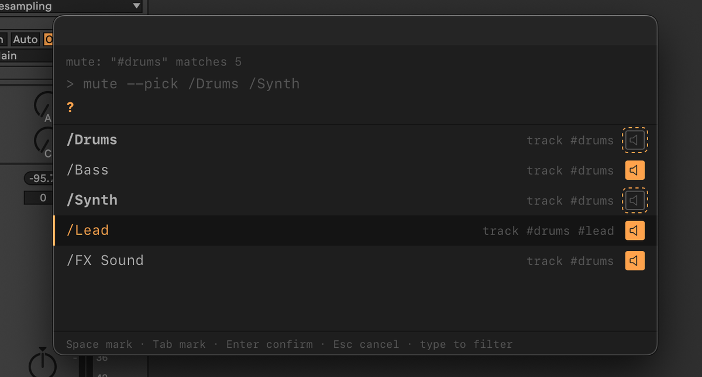
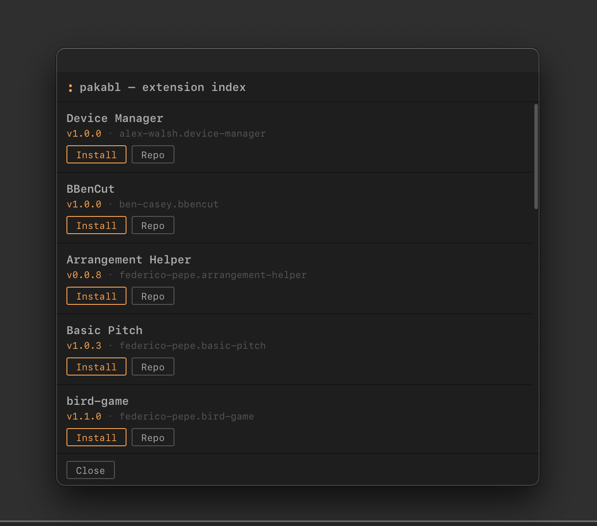

# Getting started

cmdAbl is a command palette for Ableton Live. You type a short line such as `mute /Bass`, and cmdAbl runs it on
the Set that is open. This page takes you from installing cmdAbl to your first commands. Follow the steps in order.

## What you need

- A Mac. cmdAbl has been tested on macOS only.
- A version of Ableton Live with Extensions support. The Extensions SDK is in beta; cmdAbl is built against
  version 1.0.0-beta.1 of it.
- [Karabiner-Elements](https://karabiner-elements.pqrs.org) (free), for the `:` key. This is optional. Without it,
  you open the palette from a context menu. If you want it, install it before step 2.

## 1. Install the extension

Download the latest `.ablx` file from the
[Releases page](https://github.com/MarvinHauke/cmdAbl/releases/latest). Then open Live's **Settings → Extensions**
and either drag the `.ablx` file onto the box that says "Drag and drop to install", or click **Choose file** and pick
it. `cmdabl` then appears under "Installed Extensions". If an older cmdAbl is installed, remove it first and restart
Live.

*Settings → Extensions: drag the `.ablx` onto the box, or click Choose file.*

## 2. Run `cmdabl setup`

The `:` key does not work yet, so open the palette from the context menu: right-click a clip, a track, a clip slot
or a scene, and choose **: cmdAbl**. Type `cmdabl setup` and press `Enter`. The command does two things:

- **Keyboard trigger.** It links cmdAbl's Karabiner rule into Karabiner-Elements. If Karabiner-Elements is not
  installed, the message says so and nothing is linked. Run the command again after you install it.
- **Remote Script.** It copies the companion Remote Script into Live's User Library, in
  `~/Music/Ableton/User Library/Remote Scripts/cmdAbl`. The Remote Script lets cmdAbl select tracks, change rack
  chains and pads, and keep tags. Step 3 turns it on.

Then enable the keyboard rule. In Karabiner-Elements, open **Complex Modifications → Add predefined rule**, choose
**cmdAbl**, and click **Enable**. The rule opens the palette with `:` (Shift+period, which types `:` on German
(QWERTZ) keyboards) while Ableton Live is focused.

The command ends with one line of advice and a link to step 3. You will see one of these:

- *"Remote Script 0.1.6 is shipped but not running. Restart Live … then enable cmdAbl as a control surface"*: the
  usual answer on a first install. Go to step 3.
- *"… is shipped and running"*: nothing to do. If you have just updated cmdAbl, restart Live once.
- *"… is shipped, but Live still runs 0.1.x. Restart Live to load Remote Script 0.1.6"*: you updated cmdAbl.
  Restart Live.

## 3. Turn on the Remote Script in Live

The copied script does not appear in Live's Control Surface list until Live restarts. Do both steps:

1. **Restart Live.** After the restart, cmdAbl appears in the Control Surface list.
2. Open **Settings → Tempo & MIDI → MIDI**. Under **Control Surface**, choose **cmdAbl**. Leave Input and Output
   set to *None*. Choosing it starts the script; you do not need to restart Live again.

*Settings → Tempo & MIDI → MIDI: Control Surface set to cmdAbl, Input and Output set to None.*

Check that it works:

- Run `cmdabl bridge` in the palette. It sends one request to the Remote Script and reports its version, the protocol
  version, the response time and the operations it supports.
- Live's log also shows `cmdAbl [script] listening on 127.0.0.1:27185`. That line appears once cmdAbl is chosen as
  Control Surface (after `cmdabl setup` and a restart). The log is `~/Library/Preferences/Ableton/Live <version>/Log.txt`, where `<version>` is
  your Live version. The Remote Script's lines contain `RemoteScriptMessage: (cmdAbl)`.

*`cmdabl bridge` on a current install.*

If `cmdabl bridge` says the script is not running, the [Remote Script](remote-script.md) page explains each message
and what to do.

## 4. Open the palette

With the rule from step 2, press `:` with Live focused. (On German keyboards that is Shift+period.) The context menu
from step 2 works too.

| Key | What it does |
| --- | ------------ |
| Type | filters commands and objects of the Set |
| `Tab` | completes the selected item into the input |
| `Enter` | runs the typed line or the selected item |
| `↑` / `↓` | moves through the list |
| `Esc` | closes the palette without running anything |

*Type part of a name: tracks, devices and chains appear as rows. Enter selects the highlighted one.*

## 5. Try your first commands

Type each one in the palette and press `Enter`.

- `help` lists every command with a one-line summary. `mute --help` shows the usage of one command, and
  `man mute` its full page.
- `goto /Lead` selects the track Lead in Live. Partial names work too: `goto lead`.
- `mute /Bass` mutes the track Bass, and again unmutes it. `mute --set 1 /Bass` mutes it whatever its state;
  `mute --set 0 /Bass` unmutes it.
- Tag two of your tracks, for example `tag /Kick drums` and `tag /Snare drums`. Then `mute drums` mutes both at once.
- `tag -l` opens the tag board, where you see every tag and its tracks and change them.

When a name matches more than one object, cmdAbl shows a **pick list** instead of guessing. Type to filter, press
`↑` and `↓` to move, `Enter` to choose and `Esc` to cancel. Commands that take several tracks, such as `mute`, let
you mark more than one row with `Tab`.

*A name that matches several tracks opens the pick list. The line above the filter shows the command that Enter
will run, and the buttons show the state that Enter would set.*

[Using cmdAbl](using.md) covers names, the pick list and tags in full.

## What works without the Remote Script

The palette, `help`, `man`, `lom`, `cmdabl log` and the history work without the Remote Script. So do `mute`, `solo`
and `arm` on tracks. These need it:

- Track selection: `goto`, `find`, `next`, `prev`, and picking an object row in the palette. They report that the
  Remote Script is not running and select nothing.
- Tags: `tag`, and targets such as `#fx`.
- `mute` and `solo` on rack chains and Drum Rack pads. These also need macOS.

With the Remote Script, `arm` also reports tracks that Live will not arm, such as a MIDI track whose input device
is unavailable. Return, main and group tracks cannot be armed at all.

## Install more extensions with pakabl

pakabl installs Ableton Live extensions (`.ablx` files) from cmdAbl's curated list of community repositories.
Run `pakabl update` once to fetch the list. Then `pakabl list` shows the extensions, with buttons to install, update
or remove each one. Restart Live after a change.

- Update appears only when the list holds a newer version than the installed one.
- If the installed version is newer than the list's, the row says so, and cmdAbl never downgrades it.
- To install the list's version anyway, even an older one, use `pakabl upgrade <id>@<version>` with exactly the
  version the list shows.

*Install installs the extension. Repo opens its GitHub page.*

pakabl writes into Live's Extensions folder, which works today. Ableton has announced a stricter sandbox for
extensions. If it arrives, installing through pakabl may be blocked in a later version of Live, and pakabl as a
whole may then stop working. See [Known limits](limits.md).

## Next steps

- [Using cmdAbl](using.md) explains names, the pick list, tags, `find`, the log and the history.
- [Remote Script](remote-script.md) explains updating, checking and the messages.
- [Commands](reference/commands.md) lists every command.
- Write extensions? [List your extension in pakabl](pakabl-listing.md). Want to change cmdAbl? See
  [Develop](develop.md).
