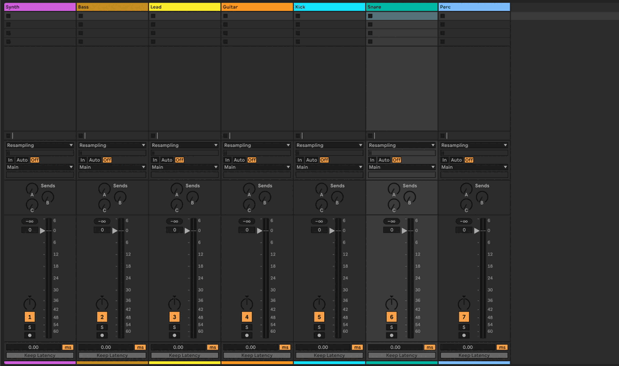
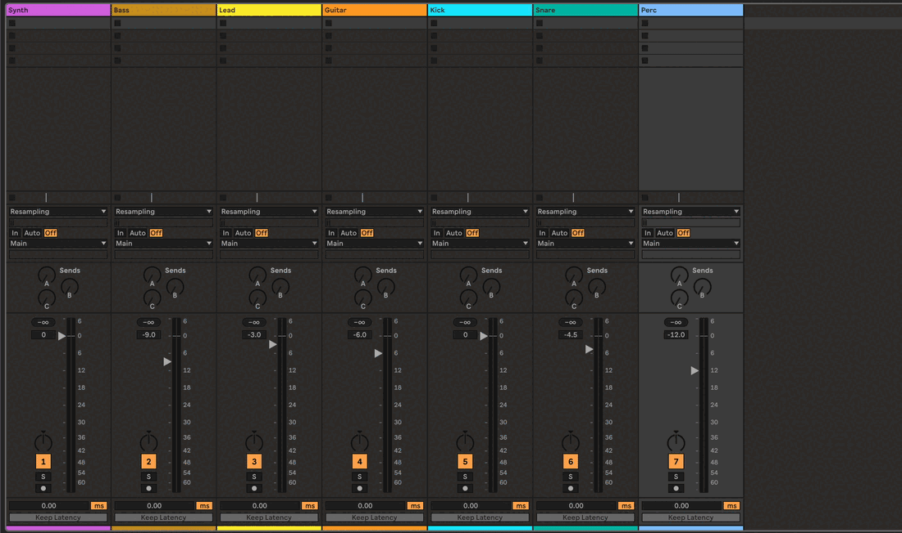

# cmdAbl

**A command palette for Ableton Live.** Press `:` while Live is focused, type a command, and it acts on your Set.





## Why cmdAbl

- **Tags that group your tracks.** `tag /Lead fx synth` tags a track. Then `mute #fx` reaches every `fx` track at
  once, and `mute !#drums` every regular track without the tag. `tag -l` opens the tag board.
- **A pick list you control.** When a name fits more than one object, cmdAbl asks instead of guessing. The buttons
  show the state `Enter` would set, and nothing changes in Live until you press `Enter`.
- **Community extensions, one list.** `pakabl` installs Ableton Live extensions from a curated community list.

[Get started](getting-started.md) walks through the install step by step.

## A short session

Type each line in the palette and press `Enter`:

```
cmdabl setup                  set up the keyboard key and the Remote Script (once, after installing)
goto /Lead                    select the track Lead
mute /Bass                    toggle the mute of the track Bass
mute --set 0 /Bass            make sure Bass is not muted, whatever its state is now
tag /Kick drums               tag the track Kick as drums (do the same for Snare)
mute drums                    mute every track tagged drums
tag -l                        open the tag board
```

## Pages

For users:

- [Getting started](getting-started.md): install cmdAbl, set up the key and the Remote Script, and run your first
  commands.
- [Using cmdAbl](using.md): the palette, how names are written, the pick list, pads and chains, `find`, tags, fader levels with
  `vol`, a note per Set, the log and the history.
- [Remote Script](remote-script.md): what it does, how to update and check it, and what its messages mean.
- [Commands](reference/commands.md): every command, generated from the code.
- [Known limits](limits.md): what cmdAbl cannot do, and macOS only for now.

For extension authors:

- [List your extension in pakabl](pakabl-listing.md): what your repository needs and how to get it on the list.

For contributors:

- [Develop](develop.md): get the SDK, build, test and send a pull request.
- [Architecture](architecture.md): how cmdAbl is built.
- [Writing a command](guides/command-authoring.md): how to add a command or a module.
- [Remote Script protocol](reference/remote-script.md): the operations of the Remote Script.
- [Live API mapping](reference/live-api.md): how cmdAbl's paths map to the Live Object Model.
