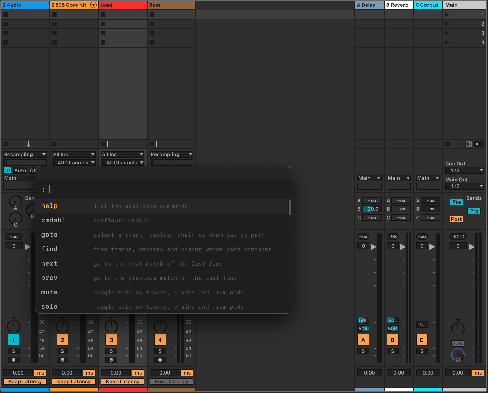

# cmdAbl

**A command palette for Ableton Live.** Press `:` while Live is focused, type a command, and it acts on your Set.



## Why cmdAbl

- **Tags that group your tracks.** `tag /Lead fx synth` tags a track. Then `mute #fx` reaches every `fx` track at
  once, and `mute !#drums` every regular track without the tag. Tags are saved with the Set.
- **A pick list you control.** When a name fits more than one object, `mute`, `solo` and `arm` ask instead of
  guessing. Mark the rows you mean with `Tab`. The buttons show the state Enter would set, and nothing changes in
  Live until you press Enter.
- **Community extensions, one list.** `pakabl` installs Ableton Live extensions from a curated community list.

[Get started](getting-started.md) walks through the install step by step.

## A short session

Type each line in the palette and press `Enter`:

```
cmdabl setup                  set up the keyboard key and the Remote Script (once, after installing)
goto /Lead                    select the track Lead
mute /Bass                    toggle the mute of the track Bass
mute --set 0 /Bass            make sure Bass is not muted, whatever its state is now
tag /Bass fx                  toggle the tag fx on the track Bass
mute --set 1 #fx              mute every track tagged fx
```

## Pages

- [Getting started](getting-started.md): install cmdAbl and try the first commands.
- [Using cmdAbl](using.md): the palette, how names are written, the pick list, tags, pads and chains, history.
- [Remote Script](remote-script.md): what it does, how to install, update and check it, and its messages.
- [Command reference](reference/commands.md): every command, generated from the code.
- [Live API mapping](reference/live-api.md): how cmdAbl's paths map to the Live Object Model.
- [Architecture](architecture.md): how cmdAbl is built, for people who want to extend it.
- [Guides](guides/README.md): writing a command, releasing cmdAbl, the pakabl index and CI.
- [Known limits](limits.md): what does not work yet, and macOS only for now.
