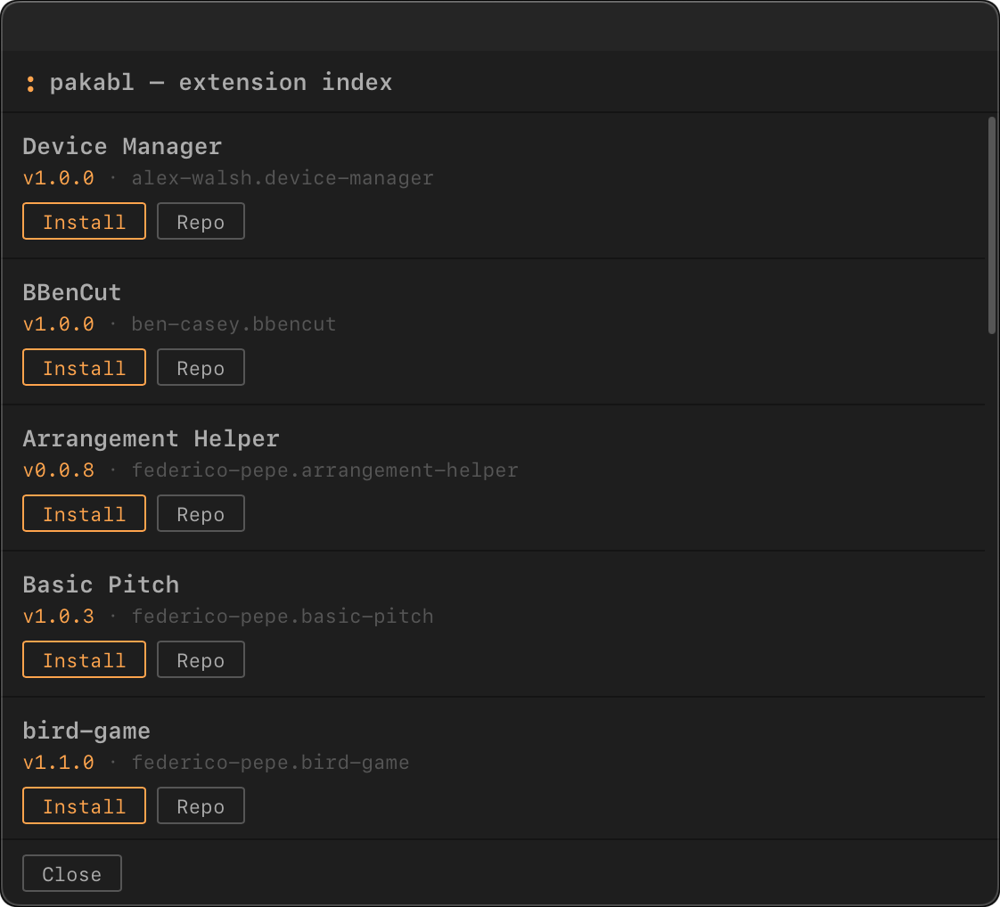

# pakabl

pakabl installs Ableton Live extensions (`.ablx` files) from cmdAbl's curated list of community repositories. It is a
command in the palette: you fetch the list, browse it, and install, upgrade or remove an extension. Restart Live
after every change.

Write extensions? See [Add your extension to pakabl](develop-pakabl.md).

## Fetch the list

Run this once, and again whenever you want to see new versions:

```
pakabl update
```

`pakabl list`, `pakabl install` and `pakabl upgrade` need the list.

## Browse the list

```
pakabl list
```

This opens a window with the extensions on the list. Each row has buttons to **Install**, **Update** or **Uninstall**
that extension, and a **Repo** button that opens its GitHub page.



*Install installs the extension. Repo opens its GitHub page.*

- Each row shows the repository's stars (`★`) and the downloads of its releases (`↓`; `↓ –` when the extension is not a
  release download). `pakabl update` fetches the counts with the list and they are at most a day old, and they disappear if they could not be refreshed for a week.
- **Update** appears only when the list holds a newer version than the installed one.
- If the installed version is newer than the list's, the row says so, and cmdAbl never downgrades it.

## Install, upgrade and uninstall by command

Each row of `pakabl list` shows the extension's id, written `author.name`. Use it in these commands:

```
pakabl install federico-pepe.snake
pakabl upgrade federico-pepe.snake
pakabl upgrade federico-pepe.snake@1.2.0
pakabl uninstall federico-pepe.snake
```

- `pakabl install <id>` downloads the extension and unpacks it into Live's Extensions folder.
- `pakabl upgrade <id>` installs the list's version, but only when it is newer than the installed one.
- `pakabl upgrade <id>@<version>` installs that version anyway, also an older or the same one. Use exactly the
  version the list shows; the command stops when the list holds another version.
- `pakabl uninstall <id>` deletes the extension from Live's Extensions folder.

Press `Tab` after the command to complete the id. pakabl puts each extension in Live's Extensions folder; restart Live
after a change. Every option of each command is in the [command reference](reference/commands.md).

## A limit to know

pakabl writes into Live's Extensions folder, which works today. Ableton has announced a stricter sandbox for
extensions. If it arrives, installing through pakabl may be blocked in a later version of Live, and pakabl as a
whole may then stop working. See [Known limits](limits.md).
