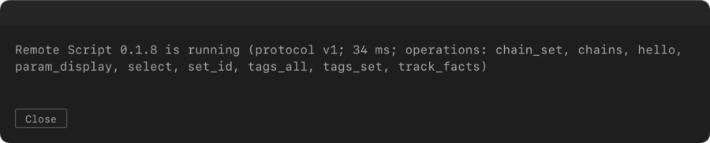

# The Remote Script

cmdAbl has two parts. The extension runs inside Live and handles the palette. The Remote Script is a small Python
script that runs inside Live as well, and does the jobs the Extensions SDK cannot do. This page explains what it
does, how to install, update and check it, and what its messages mean.

## What it does

The Extensions SDK cannot do some things that cmdAbl needs. The Remote Script does them:

- **Select.** The SDK cannot change the selection. `goto`, `find`, `next` and `prev` use the script to select a
  track, a device, a rack chain or a Drum Rack pad. This includes racks nested inside a chain.
- **Chains and pads.** The SDK cannot mute or solo a rack chain or a Drum Rack pad. `mute` and `solo` use the
  script for them.
- **Tags.** The SDK has no place to keep tags in the Set. The script stores them on the tracks, so they are saved
  with the Set. `tag`, the tag board and targets such as `#fx` use it.
- **Facts the SDK does not show.** Live can refuse to arm a track, for example a MIDI track whose input device is
  missing. The SDK reads back "armed" in that case. The script reads the real state, so `arm` can report the track
  as failed.

The script talks to the extension over a local socket, only on your Mac. See [How the two talk](#how-the-two-talk).

## What works without it

Without the Remote Script the palette still opens and most commands run:

- `mute`, `solo` and `arm` work on tracks. `arm` cannot warn about tracks that Live refuses to arm.
- `lom`, `man`, `help`, `cmdabl log` and the history work.
- These need the script: `goto`, `find`, `next`, `prev`, picking an object row in the palette, `tag`, targets such
  as `#fx`, and `mute` and `solo` on rack chains and Drum Rack pads.
- Those commands answer that the Remote Script is not running. This is the usual answer for a missing script, an old
  copy that Live has not loaded and one that is not chosen as Control Surface, because cmdAbl cannot look into the User
  Library to tell them apart.

## Install it

Run `cmdabl setup` from the palette. It copies the Remote Script into Live's User Library, at
`~/Music/Ableton/User Library/Remote Scripts/cmdAbl`, and tells you what to do next.

Then restart Live, and choose **cmdAbl** under **Control Surface** in **Settings → Tempo & MIDI → MIDI**. Choosing it
starts the script; you do not need to restart Live again. [Getting started](getting-started.md) has the steps with
screenshots.

## Update it

After you update cmdAbl, run `cmdabl setup` again, then **restart Live**. Live keeps the script it loaded when it
started, so a new copy in the User Library does nothing until Live restarts.

The script of this release is version 0.1.6. `cmdabl setup` compares that version with the one that is running and
says whether a restart is needed. For example: "Remote Script 0.1.6 is shipped, but Live still runs 0.1.5. Restart
Live to load Remote Script 0.1.6."

## Check it

Run `cmdabl bridge` in the palette. It sends one request to the Remote Script and reports its version, the protocol
version, the response time and the operations it supports. A healthy reply means the script is running and
answering.

*`cmdabl bridge` on a current install.*

If the running script is not the version this cmdAbl ships, the reply names both, for example
`Remote Script 0.1.5 (this extension ships 0.1.6) is running`. Update the script as above.

## Messages

These are the messages you can get. Each is shown in the palette:

| Message | What it means | What to do |
| ------- | ------------- | ---------- |
| *Remote Script not running (install it with `cmdabl setup`, restart Live, then enable cmdAbl as a Control Surface in Live's Settings → Tempo & MIDI)* | The script is not answering in Live. cmdAbl cannot tell "not installed" from "not enabled", so the message lists the full order. | Run `cmdabl setup` if it is not installed, restart Live, then choose cmdAbl as the Control Surface (Settings → Tempo & MIDI → MIDI). |
| *installed Remote Script is outdated; run `cmdabl setup` and restart Live* | The running script does not know an operation this cmdAbl needs, or it speaks another protocol version. | Run `cmdabl setup`, then restart Live. |
| *the Live Set changed; run the command again* | The track or pad moved or was renamed after you typed the command. | Run the command again. |
| *the Remote Script did not answer; check Live* | Live did not reply in time. | Check that Live is running and not busy, then run the command again. A change may or may not have happened, so look at the Set. |
| *the Remote Script refused the change (access token); restart Live (after `cmdabl setup` if the script was updated)* | The script refused a change, because its access token did not match. | Restart Live. After an update, run `cmdabl setup` first. |
| *cannot read the bridge access token (CODE); restart Live (after `cmdabl setup` if the script was updated)* | The extension cannot read the token file. CODE says why: `ERR_ACCESS_DENIED` (the sandbox refused the path), `ENOENT` (no file: the script has not written one) or `wrong shape` (the file does not hold a valid token). | Restart Live. After an update, run `cmdabl setup` first. |
| *changing chains is available on macOS only (no access token on this platform)* | Chain and pad changes need macOS. | Nothing to do on this platform. |

## The Log.txt lines

The Remote Script writes to Live's log, `~/Library/Preferences/Ableton/Live <version>/Log.txt`, where `<version>` is
your Live version. Live puts the time and `RemoteScriptMessage: (cmdAbl)` in front. Search for `cmdAbl [script]`. The
lines are:

| Line | Meaning |
| ---- | ------- |
| `cmdAbl [script] access token written` | The script made this start's token. "unavailable" means writing operations are refused. |
| `cmdAbl [script] listening on 127.0.0.1:27185` | The script is running. This appears once cmdAbl is chosen as Control Surface. |
| `cmdAbl [script] failed to bind: …` | The script could not open its port, for example because a second copy of Live holds it. It cannot answer. |
| `cmdAbl [script] handler error: …` | An operation failed inside the script. |
| `cmdAbl [script] dropped datagram: …` | The script ignored a message it could not read. |
| `cmdAbl [script] reply failed: …` | The script could not send a reply. |

These lines are not in `cmdabl log`, which shows the extension's own lines.

## The access token

Some operations change the Set: they set the mute or solo of a chain, or write tags. Before the script runs such an
operation, it checks a token that the extension sends with the request.

- **Where it lives.** When Live starts, the script creates a new random token and writes it to
  `~/Library/Application Support/Ableton/Extensions Data/marvinhauke.cmdabl/bridge-token`. Only you can read the folder
  and the file. cmdAbl runs in a sandbox that lets it read this folder, so the token lives there. The script
  removes the older folder, `~/Library/Application Support/cmdAbl/`.
- **When it changes.** Every time Live starts, the token is replaced. If a change is refused, the extension reads the
  file again and tries once more, so a restart of Live is usually all it takes.
- **What to do.** Never share the token file, and never paste its contents anywhere. You do not need to read it. If a
  change is refused, restart Live. After an update, run `cmdabl setup` first.

The token guards against other users on the Mac and against stray messages. It does not guard against programs you
run yourself, which can change your Set in other ways anyway. Reads and selection need no token.

## How the two talk

The extension and the Remote Script exchange messages over UDP, on `127.0.0.1`, port `27185`. Only programs on your
own Mac can reach that port, and the script answers only on that address. Each request asks for one operation and gets
one reply. A request that gets no reply within half a second is reported as unanswered.

For contributors, the [Remote Script protocol](reference/remote-script.md) lists every operation and what it does,
and the [Live API mapping](reference/live-api.md) shows how cmdAbl's paths map to the Live Object Model. Both are
generated from the code of the cmdAbl version this documentation was built from. The operations your running script
supports are the ones `cmdabl bridge` lists.
