# Using cmdAbl

This page is for daily use, after [Getting started](getting-started.md). It covers the palette, how to name the
objects of your Set, the pick list, tags, the log and the history. The exact usage of every command is in the
[command reference](reference/commands.md). In the palette, `<command> --help` shows a short usage line and
`man <command>` shows the full page.

## The palette

Press `:` with Live focused, or choose **: cmdAbl** from the context menu of a clip, a track, a clip slot or a
scene. Type a command and press `Enter`. `Esc` closes the palette without running anything.

The palette shows two kinds of rows:

- **Commands**, such as `mute` or `help`.
- **Objects of the Set**: a track, a device, a rack chain or a Drum Rack pad. Picking one runs `goto` on it, which
  selects it in Live. Selecting needs the [Remote Script](remote-script.md).

`Enter` works like this:

- On an object row, it selects the object.
- On a command row you chose (with `↑`, `↓`, `Tab` or a click), it runs the row.
- On a command row you did not choose, it runs the line as you typed it, unless what you typed is only the start of
  the command's name.
- With an empty input, it runs the highlighted row.

After a command runs, the palette closes. Only a message or a pick list can stay open.

### Suggestions for arguments

After a command name, the list below the prompt shows what fits at the cursor:

- targets, where the command takes one: your recent lines first, then tracks, chains, `#` tags (with the number of
  tracks each one has) and values;
- options, after you type `-`, and the values an option takes;
- subcommands, for a command that has them, such as `pakabl`;
- extension ids for `pakabl install`, tag names for `tag -r` and `tag -e`, and commands for `man`.

A grey hint after the cursor shows what the command expects next, such as `<target>…`, `<old>` or `<id>`. It shows
only where nothing is typed yet.

- `Tab` takes the highlighted suggestion and moves on: it adds the space. The highlight and `Tab` start at the
  first target, or at the best subcommand or option where there is no target.
- `↑` and `↓` pick a different row.
- `Enter` runs exactly what you typed. It never takes the top row on its own; it takes a suggestion only if you
  moved to that row with the arrow keys first.

A name with spaces is quoted for you.


#### Show the options above the prompt

The footer of the palette has a switch, **Above the prompt: Off · Hints · Options**. Click it with the mouse. The
choice is saved and used the next time you open the palette. The palette opens taller for **Hints** and **Options**.
If you switch while the palette is open, the layout changes fully at the next open.

- **Off** (the default): one list below the prompt. Options appear in it after you type `-`.
- **Hints**: a reference panel above the prompt, headed `Hints · <command>`, lists the command's options in
  columns: the long flag, the short flag with its values, and the description. You cannot select in it. After
  `-`, the option highlighted in the list is marked with `▸` in the panel, and a long description scrolls after a
  short moment.
- **Options**: the options sit above the prompt and you can select them. `↑` goes up into them, and `Tab` takes one.


![The palette in Options mode after `tag `: the six options of tag above the prompt, the grey hint `[<target>]` after it, the tracks below, and the footer switch set to Options.](assets/images/above-options.png)

## Name the objects

A command takes objects as text. cmdAbl reads that text as follows:

- **A full path is a target of its own.** `/Lead` is one target. Live's default track names carry their number,
  and cmdAbl keeps it: the track shown as "2 808 Core Kit" is `2-808 Core Kit`, and "1 Audio" is `1-Audio`.
- **Spaces need quotes among several targets.** `goto /2-808 Core Kit` works unquoted, because it is the only
  target. With several, quote it: `solo /Bass "/2-808 Core Kit"`.
- **`#2` picks a sibling with the same name.** Two tracks called Bass are `/Bass` and `/Bass#2`. A plain `/Bass`
  asks when two tracks have that name.
- **Other words must match the path, and one must match the name.** For `mute`, `solo`, `arm`, `goto` and `lom`,
  every word must occur in the object's path, and at least one in the object's own name. `mute 808 snare` names the
  Snare Drum pad of the 808 kit: only that object has both words in its path and one of them in its name.
- **A word that is exactly a top-level track's name names that track.** `mute bass` names the track Bass, not the
  Bass Drum pad. Below the top level this does not hold: there a word matches every name that contains it.
  `mute lead` names the track Lead, not the devices and chains below it.
- **Words typed together win when they match.** If they match one object, the command runs on it without a
  question. If they match several, one pick list offers exactly those. Only when they match nothing together is
  each word its own target. A word that then matches several objects asks once: `mute drum` asks in a Set with the
  pads "Bass Drum" and "Snare Drum".
- **A comma always names several targets.** `mute bass, lead` names the track Bass and the track Lead. This also
  fixes a surprise: with a group Drums that holds a track Kick, `mute drums kick` means the Kick, because both
  words match one object. Write `mute drums, kick` for both.

When a name matches more than one object, cmdAbl asks. It never picks one for you.

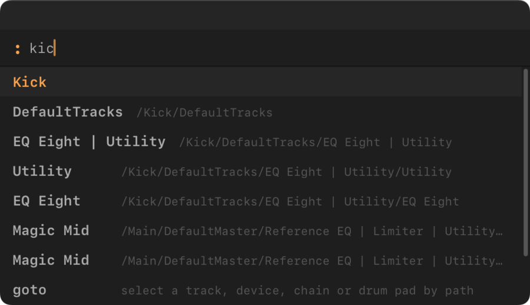

*Type part of a name, and the palette lists the objects that match.*

### Dash rules

- A word that starts with `-` is an option. `mute /Bass -6dB` is an error, because `-6dB` is not a known option.
  Quote the name, or put `--` before it: `mute -- /Bass -6dB`.
- A lone `-` is an ordinary word. A track called `Hi - Hat` can be typed without quotes.
- `--` ends the options. Everything after it is a name.

## The pick list

The pick list opens when a name matches more than one object, or when nothing matches and cmdAbl has close
suggestions.

- **Filter.** Type to narrow the rows. `Space` types a space.
- **Move.** `↑` and `↓` move through the rows. In a list where you can mark rows, the first arrow only enters the
  list, so `↓` and then `Space` marks the first row.
- **Mark.** In a list where you can mark rows, such as the lists of `mute`, `solo` and `arm`, `Tab` marks a row, and
  so does `Space` once you are in the list. Only the marked rows are targets. The row under the cursor is not one
  until you mark it.
- **Choose.** In a list where you can mark rows, `Enter` runs the command on the marked rows. With nothing marked,
  `Enter` runs nothing, the list stays open and the hint asks you to mark a row. In a list where you pick one row,
  such as for `goto`, `Enter` takes the row under the cursor.
- **Cancel.** `Esc` closes the list. Nothing runs and nothing is remembered.

The line above the filter shows the command that `Enter` will run, with the exact paths of the objects.

**State buttons.** The lists of `mute`, `solo` and `arm` show a button at the right of each row, as Live's mixer
does: a speaker for mute, lit when the track is audible; an `S` for solo; a record dot for arm. A row whose state
cannot be read has no button. Marked rows show the state that `Enter` would set, and a dashed ring marks each
button that would change. Live does not change until you press `Enter`.

**One list per command.** If several of your names are ambiguous, you get one list for all of them, with the
matches of the whole pattern first. Answer it once.

**"Did you mean".** A mistyped word gets suggestions. They are never run unasked.

- If another word of the command is ambiguous, the suggestions join that list. Each suggestion row is tagged with
  its word and a question mark, for example `"bsas"?`.
- If no word matches, the list holds only suggestions.
- A word that nothing fits at all fails at once, without a list.
- `Esc` ends the command with the plain "nothing matches" answer.
- The list takes marks for `mute`, `solo` and `arm`. For `goto`, `find` and `lom` it takes one row.

## Pads, chains and folding

Drum Rack pads and the chains of other racks are objects too. Their path goes through the track and the rack.
`/2-808 Core Kit/808 Core Kit/Snare Drum` is the Snare Drum pad of the Drum Rack on the track `2-808 Core Kit`, and
`mute 808 snare` finds the same pad.

Racks can sit inside a chain of another rack. An Instrument Rack whose chain holds a Drum Rack gives pads such as
`/Drums/Strutter Kit/Strutter Kit/<Drum Rack>/Kick Rumble`. `goto`, `mute` and `solo` work on them.

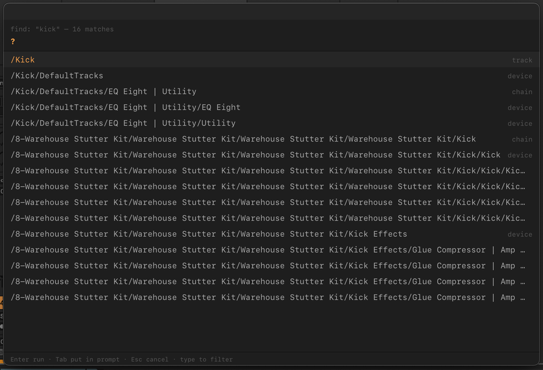

*`find kick` reaches the pads of a Drum Rack nested in an Instrument Rack.*

Selecting a pad or a chain does not change how the track is shown. Add `--unfold` to `goto` or `find` to show the
track's chains as columns in the Session mixer. Live stores this view state with the Set, so the Set counts as
changed. cmdAbl never folds the chains back; do that in Live.

## Find objects

`find` is a search, and it is looser than the commands that act on a target. `find 808` lists every track, device
and chain whose path contains `808`: the 808 track and everything below it. `find` needs the
[Remote Script](remote-script.md).

- `find 808 -L 0` lists only the objects named `808`: the track and its Drum Rack.
- `find 808 -L 1` also lists what sits one level below those objects, such as the pads of the Drum Rack.
- `find -c snare` lists only chains and pads. `-t` lists only tracks and `-d` only devices; the flags add up.
- `find kick` also finds pads inside nested racks, and `find` lists the devices inside chains.
- `next` and `prev` step through the last `find` list.

Without a pattern, `find` needs `-L` or one of `-t`, `-d` and `-c`; a bare `find` is an error.

- `find -L 1` lists the top-level tracks.
- `find -L 2` lists the tracks and their devices.
- `find -t` lists all tracks.

`-L` takes a whole number from 0 to 12 with a pattern, and from 1 without one. For finding tracks by tag, see
[Tags](#use-tags-as-targets).

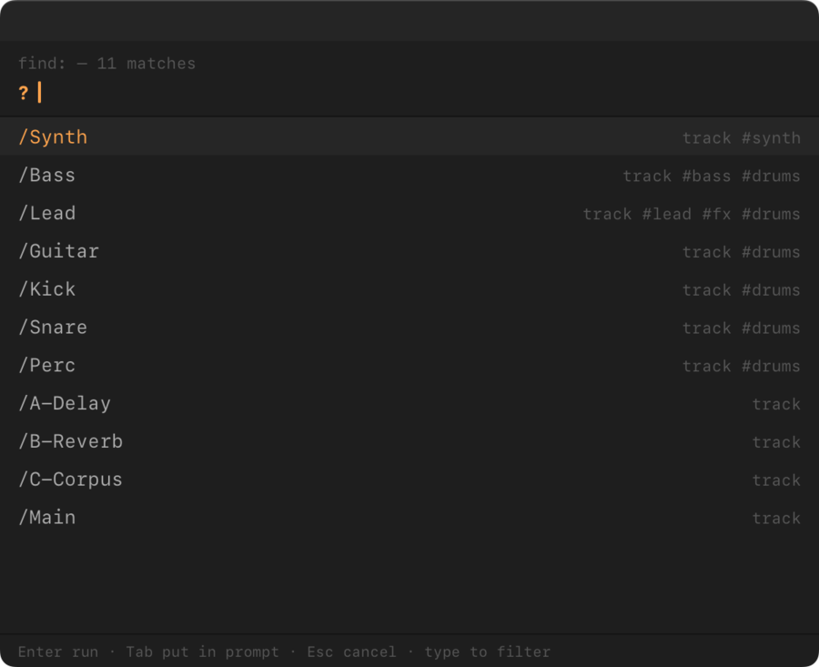

*`find -L 1` lists the top-level tracks, each with its tags.*

## Toggles, and what they do not do

- `mute`, `solo` and `arm` **toggle** each object they name: a muted track is unmuted, an unmuted one is muted.
- `--set 1` makes every named object muted, soloed or armed, whatever its state. `--set 0` switches them off. An
  object already in the wanted state counts as done. `mute --set 1 /Bass, /Lead` mutes both, and `solo --set 0 /Bass`
  unsolos the Bass track. `--set=0` works too.
- `mute` and `solo` work on tracks, rack chains and Drum Rack pads. Chains and pads need the Remote Script and macOS.
- `arm` works on tracks only. Return, main and group tracks cannot be armed, and cmdAbl reports them as failed.

**Exclusive arm and solo are not applied.** If Live's "Exclusive" setting is on for arm or solo, cmdAbl does not
follow it. `arm /Bass /Lead` arms both tracks, and `arm /Bass` does not disarm other tracks. Name every track you
want explicitly, like Cmd-clicking the buttons in Live.

## Fader levels: `vol`

`vol` moves track faders in dB (decibels). It needs no Remote Script.

- `vol <dB> <target>…` moves each fader by `<dB>` from where it is. With Kick at -6 dB and Perc at -3 dB,
  `vol -6 #drums` gives -12 and -9, so the balance between them stays.
- `vol --set <dB> <target>…` (short `-s`) puts every fader at that level. `vol --set -inf /Lead` silences the Lead
  track.
- Decimals work: `vol -1.5 /Bass`, `vol .5 #drums`.
- Targets are tracks: regular, return, group and the main track (`/Main`), by path, name or [tag](#use-tags-as-targets). A rack chain or
  Drum Rack pad is refused with "vol works on tracks for now".
- A move that went as typed is quiet, and so is a `--set` that changes a fader; if nothing moves, it says "nothing changed". One run is one Cmd+Z step. Levels are as precise as Live's display, 0.1 dB.

**Limits.** A fader goes up to +6 dB (Live's maximum) and down to -inf. The lowest level above -inf is -69.6 dB.

- By default, if one fader would cross a limit, the step is shortened for every fader, so the balance stays. The
  message reads, for example, "vol 9: moved +3.0 dB, /Kick reached +6 dB (the maximum)".

  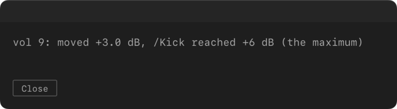

  If nothing can move, it reads "nothing changed: /Kick is at +6 dB (the maximum)". Going down, that message adds
  "use --clip or --set -inf to go lower".
- With `--clip` (short `-c`), each fader moves by the full step. The faders at a limit stop there and lose their
  balance. Below -69.6 dB a fader goes to -inf. The message reads "limit reached at +6 dB (the maximum): /Bass,
  /Lead, …". It names at most five tracks, then "+N more"; the log has them all. A fader already at -inf is left
  out.

  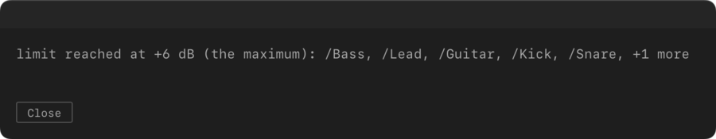
- A fader at -inf stays there with a relative step. Only `--set` brings it back.
- `--clip` together with `--set` is a usage error, and so is a relative `-inf`; use `vol --set -inf`.

**The log and undo.** [`cmdabl log`](#logs) shows what a run did: "asked +9.0 dB, applied +3.0 dB", then
`/Kick: 3.0 → 6.0 dB` and an `undo: vol --set 3.0 /Kick` line per track. `cmdabl log --undo` lists the undo lines.

**Automation.** `vol` overwrites the fader like a hand move. On a track with volume automation, Live treats it as a
manual change (see Live's Re-Enable Automation button).

## Tags

A tag marks what a track is, such as `fx` or `drums`. After you tag a track, one command can reach every track
with that tag: `mute #fx` mutes all tracks tagged `fx`, at once.

- Tag names use lowercase letters, digits, `-` and `_`.
- Tags are stored in the Live Set. They are saved with the Set, copied by Cmd+D and kept when a track is renamed.
- Regular, return and main tracks can carry tags. The board and `tag -e` list regular and return tracks only.
- Tags need the Remote Script. After you update cmdAbl, run `cmdabl setup` once, then restart Live.

This section goes from tagging a track to the tag board, `tag -e` and `tag -r`, then to what you see after a write.

### Tag tracks

- `tag /Lead fx synth` switches `fx` and `synth` on for Lead, or off where they are on.
- `tag --set 1 /Bass fx` makes sure Bass has `fx`. `tag --set 0 /Bass fx` removes it.
- `tag /Lead` opens a list of the Set's tags. Its buttons show which ones Lead has. Mark the tags to switch with
  `Tab`, then press `Enter`.

To add a tag that does not exist yet, type its name in that list. The list then shows `+ new tag "<name>"` as its
last row.

- If that row is the only one, `Enter` adds the tag.
- Otherwise, press `↓` to reach the row, then `Enter`.
- Tags you marked before still come along.
- In a Set without tags, the empty list says "type a new tag".

`tag` takes one target. `tag /Lead, /Bass fx` fails. To tag several tracks, use a tag target: see the next part.

A bare `tag` is a usage error that shows the short usage. A name with other characters than lowercase letters, digits,
`-` and `_` is refused: `tag: "x!" is not a tag name — use lowercase letters, digits, - and _`.

### Use tags as targets

In every command that takes tracks:

- `#fx` means every track tagged `fx`, at once, without a list.
- `mute #fx, #drums` acts on the tracks tagged `fx` and the tracks tagged `drums`, together.
- `!#drums` means every regular track without the tag `drums`, untagged ones included. It never means the main
  track, and return tracks only when you name them by path. `tag --set 1 !#drums synth` tags them all `synth`.
- A bare word acts like a tag when the word is a tag and no track name matches it: `mute drums` acts like
  `mute #drums`. A track such as "Drums Bus" brings up a list instead, with the tagged tracks first.
- A bare `#` opens a list of the Set's tags. Mark the tags to act on: `mute #`.
- `--pick` shows every match in a list, and only the marked rows run: `mute --pick drums`.

Commands that act on one object, such as `goto`, and destructive commands still ask when a tag matches several
tracks.

`find` understands tags too:

- `find #drums` lists the tracks tagged `drums`. `next` and `prev` step through them.
- `find !#drums` lists the regular tracks without the tag.
- `find drums` lists what the path matches and also the tracks tagged `drums`. Their rows show their tags.
- `find #drums kick` searches inside the tagged tracks. The kind flags and `-L` apply: `find #drums -c` lists the
  chains and pads of the tagged tracks.
- Without the Remote Script, `#` answers that the Remote Script is not running. Plain words work as before.

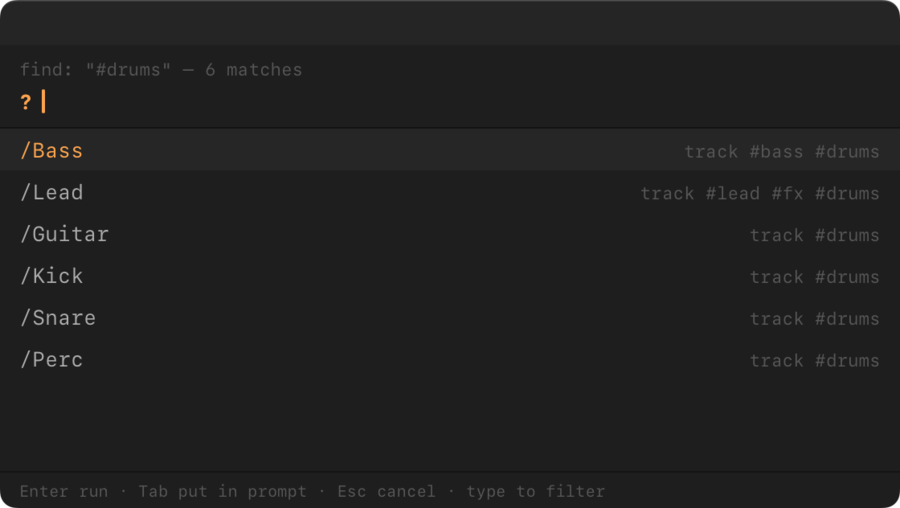

### The tag board

`tag -l` (or `tag --list`) opens the tag board. It shows one section per tag.

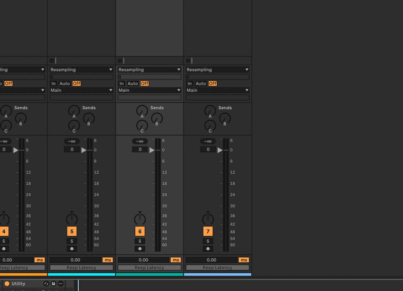

*`tag -l`: add tracks to tags, mark a chip for removal, apply. The log lists what changed.*

Each section has:

- the tag's tracks as chips. Click a chip's **×** to mark that track for removal. It is struck through. A second
  click unmarks it.
- an **add…** input. Type a track's name, and the best match shows as ghost text. The tracks that do not carry the
  tag yet show as up to six chips below it. `Tab` puts the highlighted track in the field, and `Enter` adds it. A
  click on a suggestion adds it too. A new chip has a dashed ring. "no match" means nothing was added.

At the bottom, **new tag…** creates a tag. Type a name and press `Enter`.

- Names are saved in lowercase, so "Perc" becomes `perc`.
- A name that already exists is refused with "exists already". Add the track in that tag's **add…** input instead.
- A name with other characters is refused with "not a valid name".
- Add tracks to the new tag in its **add…** input. A new tag with no track is not kept.

The **untagged** section lists the tracks without a tag. It is read-only.

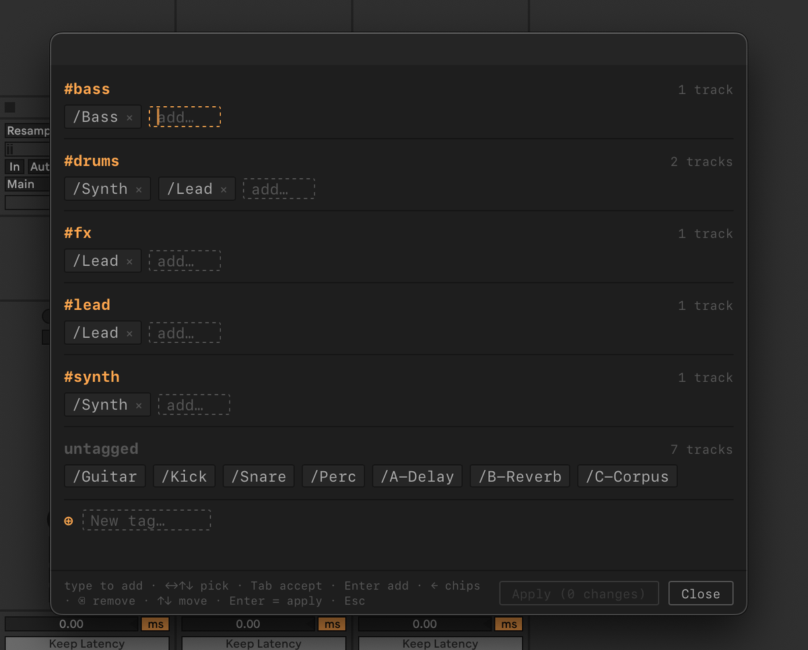

Live does not change until you press **Apply (N changes)**. Then the board closes. **Close** with nothing applied
changes nothing and shows no message.

**Keys in an add… input:**

| Key | What it does |
| --- | --- |
| typing | Suggests tracks. |
| `Tab` | Puts the highlighted track in the field. In an empty field, it moves on as usual. |
| `Enter` | Adds the highlighted track. With no match, nothing is added. In an empty field, it applies. |
| `↑` `↓` | Move through the suggestions. Without suggestions, they go to the other tags. |
| `←` `→` | Move through the suggestions. Without suggestions, `←` at the start of the field moves onto the last chip. |
| `Alt+←` `Alt+→` | Move the cursor in the typed text. |
| `Backspace` | In an empty field, marks the last chip for removal. A second press unmarks it. |
| `Esc` | Clears the typed text. In an empty field, it closes the board. |

**Keys on a chip** (after `←` onto it):

| Key | What it does |
| --- | --- |
| `←` `→` | Step through the chips. `→` past the last chip returns to the field. |
| `Backspace` `Delete` `Space` | Mark the chip for removal. A second press unmarks it. A chip you just added disappears. |
| `↑` `↓` | Go to the other tags. |
| `Enter` | Applies, when the field is empty. |
| `Esc` `Tab`, or a letter | Return to the field. |

In the **new tag…** input, `Enter` adds the name, or applies when the input is empty. `Tab` stays in the field,
and `↑` and `↓` go to the other tags. The board scrolls to keep the section you work in in view.

`Esc` with pending changes (and **Close**) warns "N changes not applied — Esc again to discard". Any other key, or
any click except Close, cancels the warning. The footer hint of the board lists the main keys.

### `tag -e`: one tag on many tracks

`tag --edit` (or `tag -e`) changes one tag on many tracks, from the keyboard.

- `tag -e fx` opens a pick list of all regular and return tracks. A "tagged fx" button is lit where a track has the
  tag.
- Mark tracks with `Tab` and press `Enter`. `fx` switches on or off for each marked track. `Esc` changes nothing.
- A bare `tag -e` means `tag -e #`: it opens the tag list first. That list takes one row: `Enter` on a tag opens its
  track list at once, and a new name plus `Enter` creates the tag.
- `--edit` cannot be combined with a target, names, `--list` or `--set`.

The pair to remember: `tag /Lead` picks the tags of one track, and `tag -e fx` picks the tracks of one tag.

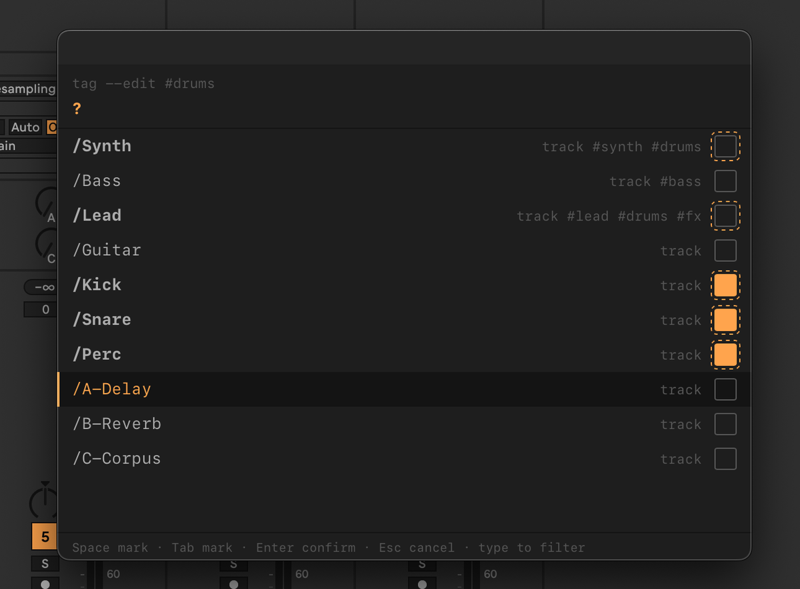

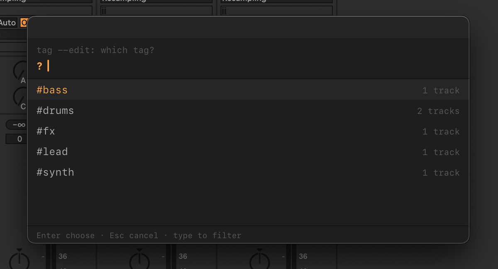

*`tag -e #drums` and the tag list of a bare `tag -e`.*

### `tag -r`: rename a tag

`tag --rename fx effects` (or `tag -r fx effects`) renames the tag on every regular and return track that carries it.

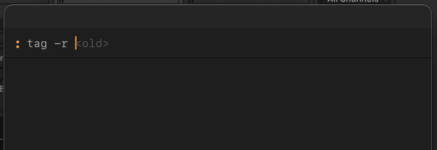

*After `tag -r`, a dim hint shows what to type next: first `<old>`, then `<new>`.*

- A leading `#` is fine in both names.
- If the new name already exists, the two tags merge. The window says "merged #fx into #effects". A track that has
  both keeps one. Renaming back cannot split them again.
- If no track carries the old name, the window says "tag: no track is tagged #fx".
- Renaming a tag to its own name says "#fx is already called that".

### After a write

A write that changes something shows nothing when it succeeds. The changes and their undo commands go to the log:

```
03:10:21 [tag] info: /Lead: +effect -fx (now #effect)
03:10:21 [tag] info:   undo: tag --set 0 /Lead effect
03:10:21 [tag] info:   undo: tag --set 1 /Lead fx
```

- `cmdabl log --undo` lists the undo commands, ready to type. See [Logs](#logs).
- **Cmd+Z does not undo a tag change.** Each track written leaves one invisible step in Live's undo list, so Cmd+Z
  may need several presses to get past them.
- Live asks you to save when you close the Set. If a message says "Live was not told about the change", save with
  `Cmd+S` so the tags are kept.
- If some tracks could not be written, a window lists only those.
- A write that changes nothing says so: "/Bass already has #bass" or "/Bass has no #fx" for one track with
  `--set`, and "nothing changed" for several.

## Look up a Live Object Model path

`lom <target>` shows the Live Object Model path of a track, device or chain, and links to the reference page for its
kind. Use it when you write a script, or to check what cmdAbl sees. The [Live API mapping](reference/live-api.md)
shows how cmdAbl's ports and Remote Script operations map to the Live Object Model.

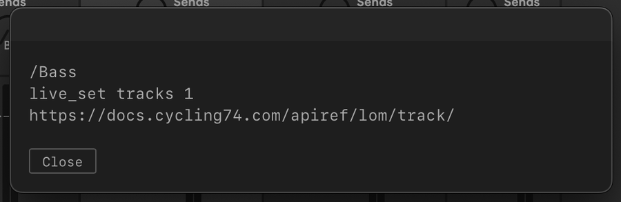

*`lom /Bass` shows the object's cmdAbl path, its Live Object Model path and the reference page for its kind.*

## Read a command's page

- `<command> --help` shows a short usage: the usage line, and each subcommand, option and argument on one line. It
  says `more: man <command>` when a full page exists.
- `man <command>` shows the full page inside Live, offline: summary, usage, options, arguments and examples. Its
  **Open in browser** button opens the command's section on the web. It finds a command by its words, so
  `man history clear` and `man cmdabl setup` work.
- `man ableton` opens the Live manual, and `man ableton <words>` searches it.
- `man cmdabl` opens the cmdAbl documentation.
- The web manuals need an internet connection. The command page does not.
- An unknown command answers with close matches under "Did you mean".

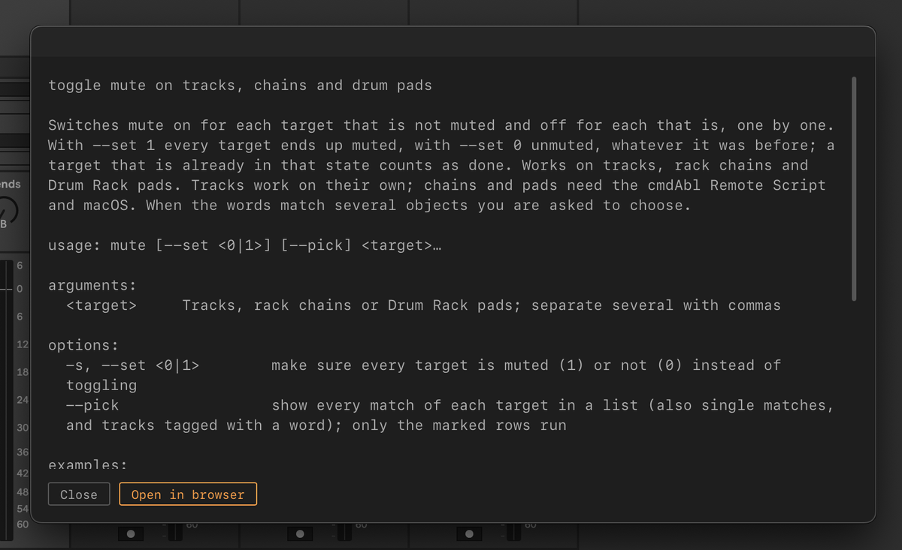

## A note per Set: `note`

`note` opens a note that belongs to the current Live Set, for things like a to-do list or a mix plan. It needs the
[Remote Script](remote-script.md); without it the command stops with exit code 5.

- `note` shows the note, rendered: headings, lists, checkboxes, tables, code, bold and italic. Links show as text.
- `note -e` (long form `--edit`) opens it for editing. A Set without a note opens in edit mode on an empty page.

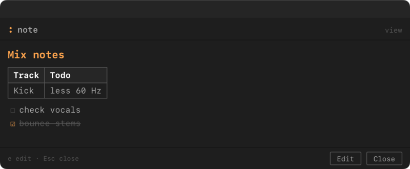

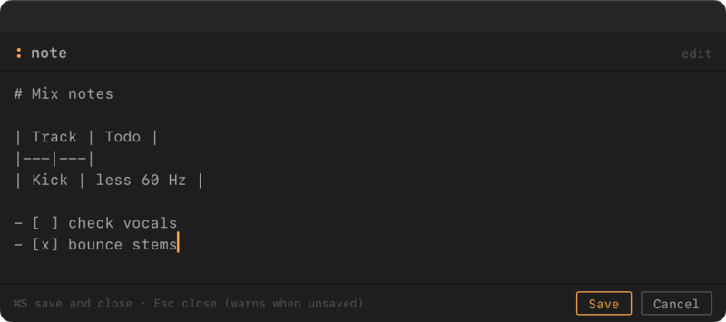

Keys in the note window:

- `e` switches from view to edit.
- `Cmd+S` or **Save** saves and closes.
- `Esc` in view closes the note.
- `Esc` in edit with unsaved changes warns first. A second `Esc` discards the changes.

**Where the note lives.** The note is plain Markdown. It is stored as a file in cmdAbl's data folder (the Extensions
Data folder in Ableton's Application Support) and linked to the Set by an id that is saved inside the Set. Viewing
never changes the Set. The first save adds the id, so Live asks you to save the Set. Save it, or the link is lost.

**Save As and Collect All and Save.** The note stays with the Set's id. After Save As, both Sets show the same note,
and editing it in one changes it for both. Collect All and Save keeps the note.

**After a save.** A save is quiet; `cmdabl log` shows "note saved". If saving fails, the message says so, and the next
`note` opens your text again until cmdAbl restarts.

## What the palette tells you

After a command runs, cmdAbl shows a short message only when there is something to say:

- **It worked.** A successful command with no message shows nothing.
- **It failed.** A message says why, and for several objects it lists each one with a tick or a cross.
- **It could not find the object.** The name matches nothing, and no suggestion helped.
- **It needs the Remote Script.** The Remote Script is missing, outdated or not running. The
  [Remote Script](remote-script.md) page says what to do.

A name that matches more than one object is not an error: the pick list answers it.

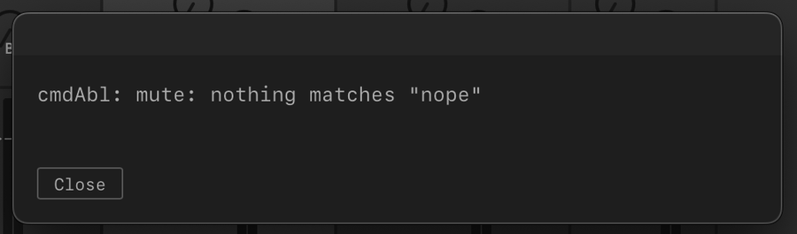

*`mute nope`: no object matches, and the message says so.*

## Logs

cmdAbl writes what it does to a log: what commands ran, what changed, the undo lines of tag writes, and
diagnostics.

- `cmdabl log` shows the last 50 lines, newest at the bottom.
- `cmdabl log -n <count>` shows up to 500 lines.
- `cmdabl log --undo` shows only the undo commands, one per line, ready to type.
- `cmdabl log --debug` turns debug lines on for the rest of the session.

The log keeps the last 500 lines of the session. A line reads `HH:MM:SS [<source>] <level>: …`, for example
`14:05:31 [run] info: start: mute /Bass`. `<source>` names the part that wrote the line, such as `run` for each
command or `dialog` for the dialogs. A line `YYYY-MM-DD` appears where the day changes.

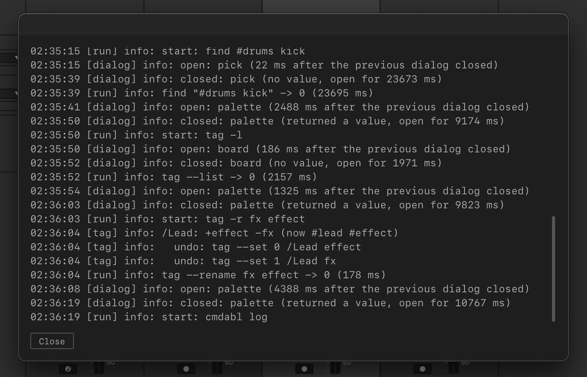

The Remote Script writes its own lines (`cmdAbl [script] …`). They are not in `cmdabl log`, only in Live's log file,
`Log.txt` (see [Getting started](getting-started.md)). Search that file for `cmdAbl [script]`.

## History

cmdAbl remembers the last 20 commands that worked and had arguments. They appear at the top of the empty palette,
newest first.

- `↑` and `↓` choose a remembered line, and `Enter` runs it again.
- `Tab` puts the line into the prompt, so you can edit it first.

A remembered line keeps:

- **Object targets** (a track, a device, a chain or a pad) by their full path. A rerun never asks again, even if a
  later track has the same name.
- **Tag targets** (`#fx`, `!#drums` or a bare tag word such as `mute drums`) and `--pick` as you typed them. A rerun
  resolves them again: a track tagged since then is included, and `--pick` opens the list again.
- **A bare `#`** as the `#name` tags you chose.

The history is kept in memory. It is gone when cmdAbl restarts.

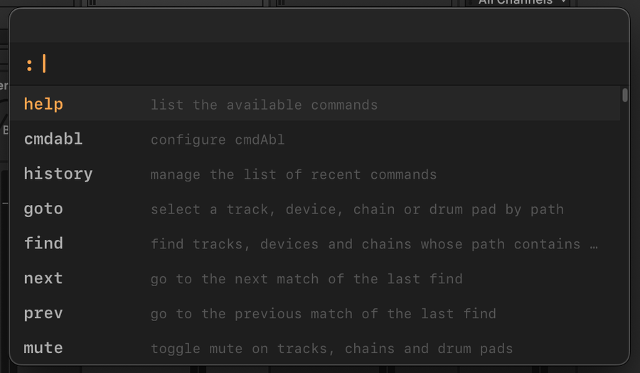

*With no history, the empty palette lists only the commands.*

### Clear, forget and restore

The `history` command manages the list:

- `history clear` removes all entries after a question. `history restore` brings them back until cmdAbl restarts.
  `history clear --force` (or `-f`) asks nothing and drops the removed entries too, so they cannot be restored.
- `history forget` removes the newest entry without asking, for example after a mistyped command.
  `history forget -n 3` removes the newest three. `-n` takes a whole number from 1 to 20.
- `history restore` puts back the entries that the last `clear` or `forget` removed, newest removal first, until
  cmdAbl restarts. `history restore -n 2` brings back the two most recently removed entries. Entries keep their
  original order, and an entry already in the history again is not added twice.

The [command reference](reference/commands.md) has the full usage.

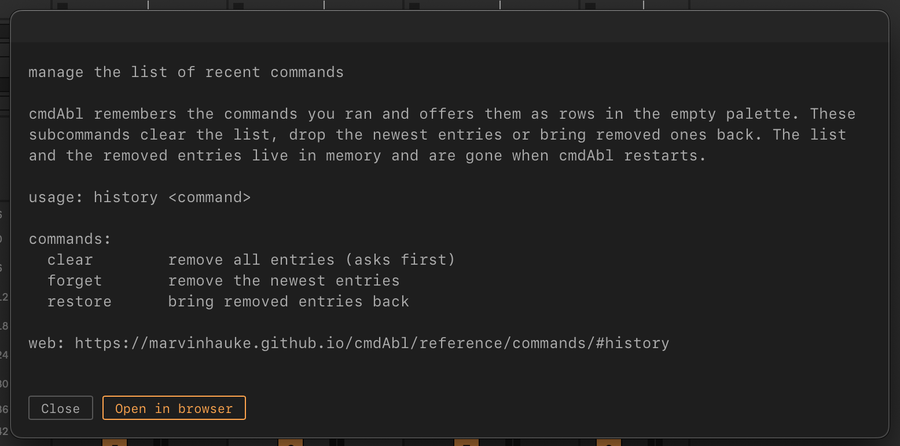

*`man history` shows the page of the history command.*
